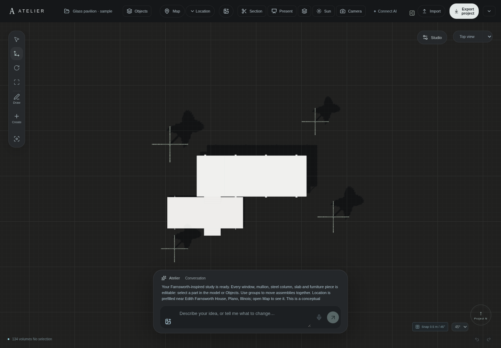

# Editable Farnsworth-inspired study

Open **Projects → Open sample house**, or use **Explore an editable sample house** on the first screen. Each opening creates a separate copy. Existing projects and previously edited samples are saved and preserved.

The updated study has **134 independently editable objects in six groups**:

- Travertine floor and roof slabs, with a sheltered porch.
- Eight I-section steel columns, base plates and perimeter edge members.
- Individual glazing panels, mullions, sills, heads and an entry door/handle.
- Timber core panels, a hearth, kitchen cabinetry, dining furniture, lounge and sleeping platform.
- Lower terrace, supports and both flights of steps.
- Four transparent tree silhouettes and a raised-arm Modulor-inspired scale cutout.

Click a part to move it, then open its dimensions to resize or rename it. **Objects → Find objects** searches names and groups (for example `window`, `mullion` or `Kitchen`). Use **Layers and groups** to select, move, hide or lock an assembly. The roof and floors are ordinary editable objects, not a baked exterior mesh. Thin panes and frames retain real thickness; transparent rendering does not replace solid geometry.

## Corrected terrace layout

The lower platform now measures **16.68 × 6.88 m** and projects **6.57 m beyond the west edge of the upper porch**. Its north edge sits 0.24 m clear of the upper slab in plan. The original sample incorrectly aligned both west edges and used a much shorter 12 m platform. The frame uses the reference’s approximately 6.706 m bay spacing. The lower terrace has three front I-section posts and one west return, sharing two porch-side columns with the upper pavilion; two aligned 3.66 m wide flights use thin separate treads, including a fourth garden tread. Every part stays editable. Floor heights, the simplified interior and remaining construction details are still conceptual.

For this correction, the actual `Document.xml` parameters in [bitacovir's deck reconstruction](https://github.com/bitacovir/Farnsworth-House-3D/blob/5daca3f6132a3f29722e3ec21e4784e0993a4fa4/3D_Files/FC%20FarnsworthHouseDecks.FCStd) were inspected: `Rectangle033` lower mortar bed 16.679215 × 6.87605 m, `Rectangle034` upper bed 23.54 × 8.708 m; their placements imply a 6.570816 m west projection and 0.242300 m plan gap. These are secondary reconstruction measurements, rounded for this sample, not a new survey. No source CAD geometry is copied or redistributed.

The reconstruction cites the [Library of Congress HABS drawing set](https://www.loc.gov/resource/hhh.il0323.sheet/?st=gallery), Columbia and MoMA. Direct access to the Library of Congress returned an outbound-policy 403 in this cloud environment. Its original sheets have **not** been verified in this update. `www.loc.gov` and `tile.loc.gov` were added to the proposed network configuration for later primary-source review. Opening a fresh sample creates the corrected arrangement; previously saved samples are not rewritten.

## Other buildings

For procedural **Floors & glass** buildings, open the inspector and choose **Edit individual components**. Review and apply to produce grouped, named slabs, windows and individual frame members at the same world placement. This is also a structured `components` operation available to the text/voice planner. It replaces procedural floor/facade controls with direct component edits; Undo restores the full original building. Large assemblies are rejected atomically when they exceed the workspace's 200-object limit. Component extraction includes the full assembly even when its display is currently set to volume or some parts are hidden.

## Scale figures and trees

All native tree recipes now evaluate to two intersecting, thin, branching silhouette solids, with 42% surface opacity in studio and hidden-line views. Wireframe shows translucent outlines. The material is also used by moodboard snapshots and AR/USDZ. No round crown primitives or external texture/model downloads are required. Existing tree placements and dimensions are preserved.

The person now has a curved, anatomically proportioned contour with a clearer head, shoulders, arms and separated feet. New figures are 0.85 m wide and use a 25 mm thick solid cutout; existing saved dimensions remain unchanged. The person is an original stylized **Modulor-inspired** raised-arm drawing, not a reproduction of an official licensed graphic. The new toolbar default has a **2.26 m reach and 1.83 m head height**. Inspector height always measures total reach. Older saved people retain their recorded overall height; they are not silently enlarged. The AI planner is instructed to convert a stated standing height into the corresponding reach. OBJ remains geometry-only and does not carry transparency/materials; project backups and USDZ retain the supported materials.

## Location and terrain status

The sample includes a **provisional map center near Edith Farnsworth House, Plano, Illinois**: 41.6354, −88.5357, satellite style, 250 m coverage. Open **Map** or **Location** to show and adjust it. Imagery is not fetched until the map is opened. The center and initial zero bearing are not a surveyed building placement or verified true-north alignment.

**Measured topography is not included.** Official house and USGS elevation endpoints were blocked by this cloud's outbound domain policy on 2026-10-19. A configuration draft adds `edithfarnsworthhouse.org`, `epqs.nationalmap.gov`, `elevation.nationalmap.gov` and `apps.nationalmap.gov`, preserving existing allowed destinations. The user must review/save and publish the environment to activate that access. No contours, river levels, terrain precision or survey elevations have been fabricated. Once access is active, elevation coverage, source resolution, horizontal/vertical datum and accuracy must be verified before bundling a terrain model. See [TOPOGRAPHY-RESEARCH.md](TOPOGRAPHY-RESEARCH.md).

This sample is a conceptual reconstruction for trying modeling tools, not a measured conservation model or construction document. Architectural reference reviewed: [bitacovir's FreeCAD Farnsworth House model and cited primary drawing sources](https://github.com/bitacovir/Farnsworth-House-3D). ATELIER's geometry and entourage drawings were authored here; no external CAD model was imported or redistributed. Loading or manually editing the sample uses no AI credits.
