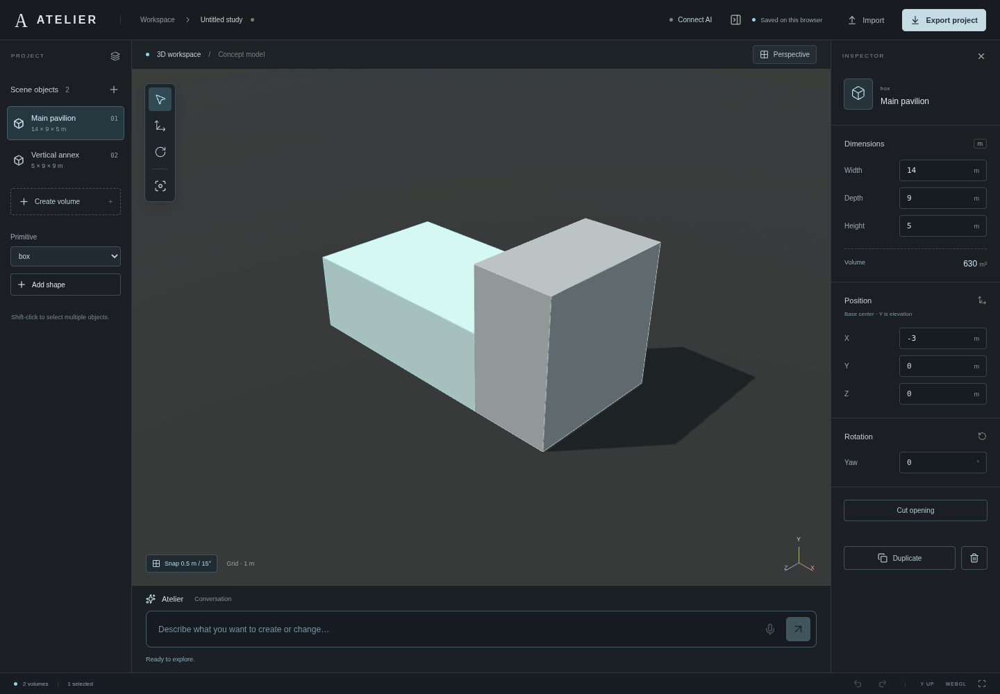

# Phase 2 validation evidence

Validated in the Codex Cloud Linux environment using Node.js 24.19.0, Chromium 154 and software WebGL. This file distinguishes geometric execution, UI/provider contracts and live AI/audio behavior.

## Passed

- **44 unit/integration tests** across model compatibility, structured plan validation, camera-relative directions, engine execution, Manifold geometry, history persistence, API access protection and actual SDK request/response contracts. Hosting checks verify trusted HTTPS origin configuration behind a proxy, secure login cookies, foreign-origin rejection and authenticated voice-session routing using an explicit provider double. Provider error tests verify actionable billing/key/configuration messages without exposing upstream errors.
- **11 Chromium tests against the production Node server:** rendering/orbit/top view, collapsible inspector, legacy-data preservation, exact editing, profiles/extrusion, raycast selection, conversational UI execution using explicit model-response fixtures, destructive review/stale-plan protection, export/import, translation handles, missing-credential behavior, editable wall openings through reload and undo, and session-import timeline preservation with a receiving-session backup. The suite also requests the real `/healthz`, `/api/config` and `/api/plan` routes to verify the combined server and honest missing-key behavior.
- **TypeScript check and production build**, including the packaged Manifold WASM asset.
- **Static Pages smoke test** at `/atelier/`: JS/CSS/WASM paths, actual mesh rendering, direct exact editing, reload persistence and honest disconnected AI/disabled voice state. The expected unavailable `/api/config` endpoint on a static site is explicitly distinguished from failed asset requests.
- **Application-server startup:** both development and production services returned ATELIER HTML and `/api/config`. Without a credential, `/api/config` reported `configured:false` and `voiceConfigured:false`; `/api/plan` returned HTTP 503 with a configuration explanation.
- Formatting and Git whitespace checks passed.

## Numerically verified geometric operations

- Boxes, tessellated spheres/cylinders, rectangle/circle profiles and extrusion.
- Union, subtraction and intersection with known volumes; closed mesh edge incidence; Manifold `NoError` status.
- Empty intersections/non-intersecting cuts rejected without losing operands.
- Stable first-operand identity and preserved recursive operand recipes.
- World and camera-relative transforms, approximate resizing, duplication/arrays, clear-gap spacing, base-center alignment and overlap placement.
- Real openings through walls, editable cutter width/height (including rotated and nonuniformly scaled results), and measured solid-volume changes.
- Undo/redo through serialization and restoration, including Boolean operand identity.

The requested sequence—create two boxes, move the second right, make it taller, overlap, subtract, undo and intersect, then widen the result—passed at the **structured-operation and UI-contract levels**. The UI test supplies known model-response fixtures; the production app itself has no such fixture fallback. Manifold produces the real resulting geometry. The final intersection volume changes from 288 m³ to 316.8 m³ after widening by 10%.

## Not verified live

During initial setup, `npm run test:live-ai` exited **2**, explicitly reporting that `ATELIER_OPENAI_API_KEY` was absent. These tests do **not** establish arbitrary language understanding, live pronoun/spatial disambiguation quality, or bilingual quality. See the subsequent live API diagnosis below.

Realtime SDP/tool configuration was tested through the real SDK using a test transport. This does **not** verify a live provider call, real microphone capture, audible response, continuous turn-taking, interruptions or browser media connectivity. Those checks require a configured provider account, HTTPS and a real microphone/browser session.

Required next action: securely configure the saved `ATELIER_OPENAI_API_KEY` requirement and `api.openai.com` access; restart the application server; run the live text check and then perform the spoken success sequence in an HTTPS browser. The live script stops for clarification rather than treating ambiguity as a pass. No secret should be provided in chat or placed in frontend code.

## Inspected screenshots

The production workspace:

A genuine Manifold wall cut with editable opening dimensions:

## Practical limits

Vite builds successfully with its size advisory (approximately 1 MB application JavaScript before compression, plus approximately 541 kB WASM). Manifold's conditional Node-only module is externalized in the browser build; the production browser tests exercised the browser path successfully. Large-model performance, Safari/mobile behavior, multi-user hosting and exact analytic CAD/BIM exports are not certified. Terrain/site workflows remain on the roadmap.

Local test results alone do not establish a public deployment, GitHub Actions execution, new cloud snapshot or live AI/voice session. The existing Phase 1 `main` branch is preserved while Phase 2 is prepared on its feature branch.

The Render blueprint and [browser-only activation guide](HOSTING.md) are in the repository. During initial setup Render account access and an OpenAI key were absent. Subsequent authorized Render API access confirmed deployment of commit `28f8541` as `live` at https://atelier-emxi.onrender.com. This establishes deployment, not successful AI/audio behavior. The reusable Codex startup instructions were saved as a draft; that save does not publish the application.

## Live API diagnosis — October 16, 2026

The user's sphere-on-prism request was reproduced against OpenAI with the deployed service's credential, used only in memory without printing or persisting it. The API rejected the generated schema with HTTP 400, `invalid_json_schema`: `oneOf` is not permitted at `operations.items`. Zod's discriminated union emitted that unsupported keyword; fixture responses had not enforced this provider restriction.

The wire schema now uses `anyOf` for the operation union. Unique literal `type` values keep its branches mutually exclusive, and the original strict Zod validator and geometry constraints are unchanged. The SDK contract test checks the actual serialized request for the supported union, distinct types and strict required fields.

After this correction, live requests for “Create two boxes” and the original sphere-on-prism instruction returned HTTP 429, `credit_balance_exhausted`, stating that API credits must be added. No model plan or new geometry was produced. Billing must be resolved before live modeling or voice can be verified. The backend now reports recognized billing, authentication and schema errors using fixed safe messages instead of exposing raw upstream errors or hiding every cause behind the generic plan failure.
