# Phase 2 validation evidence

Validated in the Codex Cloud Linux environment using Node.js 24.19.0, Chromium 154 and software WebGL. This file distinguishes geometric execution, UI/provider contracts and live AI/audio behavior.

## Minimal interface, phone actions and assembly diagrams — October 29, 2026

The [interface guide](INTERFACE.md) covers the revised controls. A single writing surface, grouped Tools menu, quieter header and navigation rail, direct Day/Night switch and collapsible conversation replace the former stacked phone controls. New installations start in Day mode; saved appearance preferences remain intact. Minimizing conversation preserves the draft and shared conversation/voice component. Opening a geometry review or reporting an error reveals it again.

**203 unit/integration cases in 54 files pass across the suite and focused reruns.** New tests cover role-aware exploded assemblies, hosted descendants independent of file order, selected scope, environment preservation, exact reassembly and origin/elevation-independent offsets. A geometric integration test exceeded its five-second timeout while browser WebGL tests were running; its focused rerun passes. The offset test uses numeric tolerance for normal floating-point translation differences.

**22 distinct targeted production-browser scenarios pass across the regression and focused runs.** These cover desktop/phone Day and Night, draft preservation through minimization, menu and panel navigation, actual press-and-hold picking, Delete/Undo, double-tap focus and empty-space reframing, drag suppression, simultaneous pan/pinch/twist and cancellation, actual exploded guides and orthographic framing, door interaction/reassembly, existing components/alternatives/views, image references, project transfer, the sample house, camera overlay and native/XR AR handoffs. Double-tap input timestamps are explicitly spaced in CDP so slow software-WebGL acknowledgements do not turn a double-tap into two separate taps. This does not simulate physical iPhone performance.

The TypeScript/Vite production build, static `/atelier/` Pages smoke, formatting and whitespace checks pass. Screenshots of the phone canvas/composer/actions/menu, both desktop themes and the exploded axonometric were visually inspected. Review corrected an oversized checkbox, project-name truncation, old theme/backdrop overrides, the projection label, and empty-space reframing after a saved focus. No paid AI request, hosting-account change or new credential is required. Physical iPhone Safari and real AR tracking remain unverified; provider/native-transport fixtures are explicit. The full historical browser suite was not rerun for this interface update.

## Clean studio, design exploration and reference images — October 28, 2026

The current workflow is documented in [Create, explore and model from references](EXPLORE-DESIGN.md). The source import cap is still 512 MB / 5 million output triangles; no smaller import restriction was introduced.

**200 unit/integration tests in 53 files pass**, including component relationships and selection-order-independent group movement, preserved window dimensions, hinge and hosted-handle geometry, alternatives/undo/session roundtrips, room layout collision rollback, cutaway planes, streamed OBJ parsing and adaptive AR copies. The TypeScript/Vite production build and the static `/atelier/` Pages smoke pass. The static smoke uses actual FBX, panorama/moodboard assets and a real worker-generated USDZ.

**107 distinct production-browser scenarios pass across sequential batches and focused reruns**, rather than a single uninterrupted suite. Browser checks cover direct Box/Cylinder/Sphere creation; desktop and phone day/night panels; reversible door/exploded presentation; alternative preview/apply/reload; saved camera and actual room cutaways; photo attachment, scale input and retained follow-up context; ordinary 2D drawing/extrusion; selection and group transforms; map alignment; camera placement; and existing floor-cut/native-handoff/camera-overlay paths. Test selectors were migrated from the former exposed toolbar to the shared Tools menu. Phone panel/footer overlaps, conversation coverage of Undo, the selection label colliding with camera controls, and group/host transformation ordering bugs found during review were fixed.

A **synthetic 300 MB OBJ** contains **1,065,800 genuine triangles plus comment padding**. Full import and actual AR preparation pass without a page reload; the generated AR copy stays at or below 100,000 triangles and all original faces remain saved. This independently exercises file size and substantial geometry; it is not the user's own asset or 300 MB of pure geometry. Full OBJ reading avoids a complete text string and expanded normal/UV arrays. Long exporter comment lines are discarded incrementally; a regression found and fixed a premature rejection of a 10 MB metadata comment. Adaptive simplification can remove fine/disconnected features only from the disposable AR copy. Device memory remains a practical limit.

Chromium touch events test simultaneous two-finger pan/pinch/twist, transitions to one finger and cancellation without accidental selection or project edits. These are browser simulation tests, not physical iPhone Safari or native Quick Look benchmarks. The phone/day/night screenshots were visually inspected.

Image and conversational browser tests use **explicit provider fixtures**, exercising the actual application request, validation, geometry and persistence paths. No paid AI requests were made. Live image interpretation quality, continuous microphone conversation and real-world native AR tracking/placement remain unverified. Image-based massing is a measured concept when the user supplies a scale, not photogrammetry or BIM reconstruction. Existing hosting credentials and app functionality are preserved.

## Bounded AR preparation and real floor cuts

The user's recording was inspected as a frame sequence: it shows “Preparing your model…” followed by the workspace boot screen before native AR opens. This is consistent with memory pressure, not proof of an iOS memory termination reason. The offset-only approach was also reported ineffective because Quick Look re-grounds the complete model. It is superseded by [AR floor cuts](AR-FLOORS.md).

**186 unit/integration tests in 49 files pass**, along with the TypeScript/Vite production build and **17 distinct targeted production-browser cases across regression and focused runs**. A desktop case inherited from the newer GitHub commit initially clicked the phone-only Tools button; it was corrected to use the desktop Camera toolbar and passed in a focused rerun. The final `/atelier/` static Pages smoke passes with an actual worker-generated USDZ as well as the existing geometry/edit/reload/FBX/moodboard/panorama checks. Formatting and whitespace checks pass.

- A genuine **1,065,800-triangle OBJ** imports in Full detail and prepares an actual meter-based USDZ of at most 100,000 triangles and below 32 MB. The page stays open, main-thread ticks continue, worker requests occur, and all 1,065,800 original faces remain saved. A second 131,072-triangle desktop import also prepares successfully. These are synthetic dense surfaces, not the user's undisclosed 300 MB OBJ or an iPhone memory benchmark.
- A stalled-worker fixture cancels and retries real preparation. A crashed-worker fixture returns an error, enables retry and retains the saved project. Permission failure, stale-module recovery, camera cleanup and both WebXR conversation themes also pass.
- Unit tests verify bounded chunk buffers, no detachment of canonical arrays, retained source dimensions/borders, rejection of irreducible/oversized output before serialization, selection scope, cancellation, empty cuts, exact triangle-plane intersections, actual removal below the chosen floor and rebasing to zero. Floor surfaces at the cut remain; wall cuts are open surfaces, not watertight caps.
- The 390 px browser check adjusts a live floor section in a compact preview, compares the whole model, prepares the cut copy, invalidates stale links, selects a slab's top elevation, rejects invalid input and restores the normal view without changing the saved project. The preview screenshot was inspected.

The newer GitHub safeguard/elevation commit was integrated: live WebXR/manual height support and legacy export height units remain; its blanket imported-face rejection is replaced by bounded input chunks, worker simplification and an independently enforced output/export limit. Floor cuts are performed before native launch, not passed as a second rigid height offset. **Physical iPhone placement and the user's actual heavy file remain unverified.** Native iPhone AR still opens Apple's viewer from an automatically prepared USDZ; no live website controls inside Quick Look, calibrated tracking, obstacle awareness, new subscription or native app is claimed.

## iPhone AR export height adjustment — October 20, 2026

**179 unit/integration tests in 48 files pass**, along with the TypeScript/Vite production build and **10 targeted production-browser tests** (`ar-camera`, `ar-experience`, `ar-loading`). The height-specific tests inspect actual USDZ transforms: negative and positive offsets, 1:1 and 1:100 ratios, retained rotation and meter units, unchanged dimensions/source bounds, invalid-value rejection and unchanged project data. The phone browser test verifies lower/raise/reset, a selected object's actual upper bound as export ground level, stale-link invalidation, scale-lock URL flags, invalid-input blocking and unchanged saved session. The 390 px layout screenshot was inspected. Existing camera cleanup, manual-preview handoff, WebXR conversation in both themes and stale-module recovery pass.

The adjustment moves the detached USDZ model vertically and scales the offset with the viewing ratio; it does not crop geometry, edit the project, resize dimensions or move a running Apple anchor. Native capability and WebXR transport are explicit browser fixtures. **Physical iPhone ground placement, below-ground visibility and whether Quick Look preserves the export offset remain unverified.** Apple may normalize placement by device/version. This is a testable export workaround, not a verified substitute for custom tracked vertical movement. No new AR engine, account, API usage or subscription was introduced. The full historical browser suite was not rerun.

## Tracked AR handoff clarity — October 20, 2026

The user expected to finish positioning the manual camera preview and then anchor it. Inspection confirmed that this screen uses an untracked Three.js camera overlay, not Apple's tracking session. A preview translation cannot be converted into a real-world anchor by adding a confirmation button.

The interface now distinguishes **Open real AR** from **Open camera preview (untracked)**. The preview always labels itself unanchored and offers **Continue in real AR** on capable devices. This stops its media tracks, exports the current scale/orientation/transparency, explains that position starts fresh, and offers a separate user-gesture launch. **Prepare life-size AR** explicitly exports 1:1 with native resizing allowed so a large building can be positioned at a smaller displayed scale in Quick Look. Saved model dimensions remain unchanged.

**176 unit/integration tests in 48 files pass.** The targeted production-browser tests exercise a real synthetic camera feed, pointer manipulation, camera cleanup, genuine USDZ output, unchanged saved session, native link/scaling flags, and the handoff UI. The new test verifies unit scale and 90-degree rotation in exported USDZ matrices while excluding the preview's distance/height offsets. It tests a trusted click on the launch link with native navigation intercepted; Chromium cannot launch Apple's viewer. Existing AR loading-recovery and explicit WebXR transport/capability regressions are included. Physical iPhone placement/gesture behavior, scale calibration and native tracking success remain unverified.

**10 distinct targeted production Chromium scenarios pass** across the nine-case AR regression and final three-case handoff/permission follow-up. TypeScript/Vite production build, formatting and whitespace checks pass. Phone preview and handoff screenshots were inspected. No native iOS app was built, no tracking service was added, and no paid AI calls were made.

## Dense edits, compact camera controls and device transfer — October 20, 2026

**176 unit/integration tests in 48 files pass.** New coverage checks immutable geometry comparisons and metadata validation without traversing mesh arrays, bounded autosave encoding reuse, unchanged exact picking under navigation simplification, stale worker replies/failure fallback, and portable project validation including history, conversation and embedded media.

The production browser regression covers a genuine 1,065,800-triangle import: recoloring retains the existing GPU mesh and shadow pass, navigation displays fewer than 300,000 triangles, full detail returns at rest, and every original face and the edited color survive save/reload. The display preview is generated in a worker and never replaces project geometry. Camera inertia now decays with elapsed time so slower rendering does not prolong movement indefinitely. Remaining limits include GPU/memory capacity and large IndexedDB writes; no hardware frame-rate guarantee is made.

The manual camera overlay starts with controls under 120 px high on a 390 px phone viewport. Actual browser pointer/touch events verify dragging, twist rotation and pinch-to-distance while retaining the 1:1 ratio, plus height/distance controls, transparency, expandable chat, unchanged saved geometry and stopped camera tracks on exit. Tests use Chromium's synthetic camera feed. Native USDZ handoff and shared WebXR conversation use explicit capability/transport fixtures. Physical iPhone performance and tracking remain unverified; manual alignment does not track walking or infer real-world depth.

Project transfer uses a real downloaded `.atelier.json` file opened through a file chooser in a separate browser context with a phone viewport. It verifies editable geometry, project name, conversation, imported undo history, reload, preservation of the receiving library, and rejection of an invalid file without replacing existing projects. Unit tests additionally round-trip moodboard and panorama attachments. The format remains compatible with prior session backups. Project copies do not synchronize; no cloud account, backend storage upgrade or paid AI call is required.

Across the regression and focused reruns, **22 distinct targeted production Chromium scenarios pass**, including real FBX imports, large-file cancellation/reduction, failed saves, project rename/delete, viewing quality, AR loading recovery, and legacy JSON import/export. TypeScript/Vite production build, formatting and whitespace checks pass. This does not represent a rerun of the complete historical browser suite. The final static `/atelier/` production smoke also passes with JS/CSS/WASM, worker imports, geometry editing/reload, moodboard and panorama loading.

## Dense imports and camera placement — October 20, 2026

File and output geometry caps are now **512 MB / 5 million triangles**, with a 256-million-character compact session budget. Full detail preserves every face while compacting duplicate position records. Optional Balanced/Phone copies use meshoptimizer with locked open boundaries and retained extents; the original/resulting counts are shown before adding. The original file is unchanged. Up to 20 million source triangles may be processed in reduced-copy modes, but the final copy must fit the output cap. These are guardrails, not a guarantee that the largest files fit every device.

Preparation runs in a cancellable module worker; raw source geometry stays off the UI thread until Add requests the prepared result. Options use revision checks to reject stale previews. Existing imports still save transactionally before changing the workspace. A genuine **1,065,800-triangle** curved facade imports at full detail, renders, saves and reopens with all faces present. A separate **201 MB comment-padded OBJ** passes the byte gate, can be cancelled, retried and imported; padding verifies file size independently of dense geometry. A 180,000-triangle OBJ exercises optional reduction and rapidly changed unit options. Early testing caught duplicate OBJ/STL vertices incorrectly locking simplification; compaction before simplification and a regression test fixed it.

**168 unit/integration tests in 44 files pass.** They include preserved full-detail faces, simplification of indexed and unindexed surfaces, retained boundary vertices/FBX placement/colors, oversized/morphed mesh rejection, reversible AR material cloning, translucent USDZ export, portrait-camera framing without rescaling, and WebXR height/transparency controls with explicit pose fixtures.

**22 distinct targeted production Chromium cases pass across focused runs.** They cover dense/large imports, reduction, cancel/save/reload/undo, real binary Revit FBX, OBJ/STL/GLB and reference imports, native USDZ handoff, module-request 404 recovery, and shared WebXR conversation in both themes. The camera controls passed a further focused run after whole-model framing was added. The complete historical browser suite was not rerun. The new manual camera overlay uses the actual getUserMedia and Three.js renderer with **Chromium's synthetic camera feed**, not physical phone hardware. It verifies permission denial, full-size viewing ratio, near/far and height nudges, rotation, finger dragging/two-finger twist, transparency, unchanged saved geometry, whole-model framing, and stopped media tracks on exit. A launch-area overlap found in the phone tests was removed. Visual inspection also found chat repaint artifacts over video after touch rotation; an explicitly layered chat host without backdrop filtering corrected them, and both day/night AR regressions passed afterward. The chat field remains clickable and editable after touch gestures.

The manual camera overlay is explicitly **untracked**: it does not follow walking or infer physical camera calibration, real-world 1:1 alignment, depth occlusion or obstacle collisions. Native Apple Quick Look remains available for tracked placement, but ATELIER cannot put custom controls/chat inside it. Physical iPhone rendering, tracking, performance and camera/microphone coexistence remain unverified. The user's own 12 MB FBX and 197 MB OBJ were not provided; generated geometry and repository fixtures were tested instead. No paid AI requests or secret/hosting configuration changes were made.

TypeScript/Vite production build and the static `/atelier/` deployment smoke pass, including worker FBX/WASM loading and existing project, moodboard and panorama behavior. See [import limits](IMPORTS.md) and [camera controls](INTERACTION-REFINEMENT.md#large-model-ar-controls--october-20-2026).

## AR module-loading recovery — October 20, 2026

A user reported Safari's “Importing a module script failed” after an update. The deployed service was live. Code inspection found that native iPhone USDZ preparation unnecessarily imported WebXR, whose hashed filename changes across builds. A stale open tab or interrupted download is consistent with this error; the user's device request log was not available, so the exact failed URL is not confirmed.

Native Quick Look and USDZ downloads now omit WebXR. AR import failures offer **Save project and refresh**, which awaits the full IndexedDB workspace save and refuses to reload after a save failure or concurrent geometry change. Cleanup uses the already loaded model module. HTML and missing-asset responses are not cached; hashed assets are immutable. This does not keep all historic deployment assets online, so an old open tab can still require a refresh. A passive storage warning no longer covers phone recovery controls.

**161 unit/integration tests in 42 files pass**, including Safari/Chromium/Firefox error classification. **Six targeted production browser checks pass across focused runs**: native USDZ export without any WebXR request, genuine module-request 404 recovery with save-failure refusal and project preservation after reload, production cache/404 headers, existing iPhone native handoff, and WebXR shared-conversation/model updates in both themes. The storage-warning obstruction found during the first recovery run was corrected, and all three loading tests then passed together. TypeScript/Vite production build and formatting/whitespace checks pass. Device capabilities and XR transport remain explicit fixtures; physical iPhone Quick Look rendering was not tested in the cloud. No API credentials or hosting configuration were replaced.

## Phone navigation, larger imports and panoramas — October 20, 2026

**160 unit/integration tests in 41 files pass.** New tests validate shared mesh serialization across all 50 undo snapshots, legacy version-2 restoration, corrupt mesh-reference rejection, panorama metadata/source validation and device-orientation mathematics. Large sessions use a version-3 mesh library without dropping geometry or history.

**16 distinct targeted production Chromium scenarios pass across focused runs.** Real touch events orbit and pan the model camera and pinch-zoom without changing geometry, history or selection. Explicit Edit mode exposes manipulation controls; phone toolbar tests cover 320/390/430 px widths. Existing Revit FBX, project rename/delete/switch, failed saves and native AR handoff regressions also pass. An initial phone overlay obstruction and a database error-message failure were fixed and their affected checks rerun.

A genuine **131,072-triangle surface** imports, renders, persists through IndexedDB with localStorage checkpoint writes deliberately failing, reloads, undoes and redoes. A separate **51 MB comment-padded OBJ** tests the byte gate, not dense geometry performance. Imports now allow 200 MB / one million triangles, bounded by a 64-million-character compact session and device resources. The maximum-sized dense file and physical iPhone performance are **not** verified. An aborted import transaction preserves the current workspace and saved project after reload.

Panorama browser tests decode/render an actual generated PNG, exercise finger drag/pinch/reset, persist the photo across reload, export/reimport JSON, isolate projects, cancel/remove photos, and constrain narrow partial panoramas on a landscape screen. Permission denial, sensor-driven rotation and stopping motion use **explicit orientation-event fixtures**, not a physical phone. Images remain local to the project; no paid model calls were made. The main modeling viewport is suspended during photo viewing.

TypeScript/Vite production build and formatting/whitespace checks pass. Phone editing and panorama screenshots were inspected. The static `/atelier/` smoke includes the lazy panorama viewer and existing real Revit FBX, geometry, editing/reload and moodboard imports. The entire historical end-to-end suite was not rerun; these are targeted regression results. Physical Safari/iPhone motion permissions, sensor accuracy and large-model performance remain to be tested on-device.

See [phone and panorama instructions](PANORAMAS.md) and [current import limits](IMPORTS.md). Panoraven itself was inaccessible under the cloud network policy; inspected public Pannellum documentation informed the interaction design. No proprietary implementation was copied, and no panorama-to-3D reconstruction is claimed.

## FBX, project management and AR controls — October 20, 2026

**156 unit/integration tests in 39 files pass.** New import coverage parses a real Revit-exported binary FBX, a second binary FBX, and authored transformed assemblies. It checks source units/up-axis, separate named elements, diffuse colors, mirrored winding, group placement, actual closed solids, Boolean eligibility, one-step undo/reload, and atomic limits. The FBX fixtures and license/provenance are in `tests/fixtures/fbx`. Materials with multiple slots use the first diffuse color; external textures and animation are intentionally excluded. This is not native Revit/BIM conversion or verification against every Revit export.

Imports now accept **50 MB and 100,000 triangles**. Browser checks cross the old 10 MB file gate with a padded FBX and the old 20,000-triangle gate with genuine 22,050-triangle geometry. They do not establish that every dense 50 MB model fits the unchanged 200-object / 2-million-character history-bearing project budget. Exceeding those limits leaves the project untouched; large FBX assemblies can be combined before import.

**22 distinct targeted production Chromium scenarios passed across focused runs**, including the final five-case AR regression and a phone toolbar follow-up. The follow-up checks that pull measurements remain below the actual wrapped toolbar at 320, 390 and 430 px widths; both pull hints and transform readouts now use its measured height. They cover existing OBJ/STL/GLB import and motion; FBX desktop/phone previews, unit conversion, separate/combined elements, reload and undo; far-camera day/night map colors; real drag selection and bulk deletion/undo; group movement and OBJ export; project rename/delete/cancel/reload and aborted database transactions; and AR preparation and shared conversation in day/night. Map tiles and AI replies are explicit fixtures. No paid API calls were made.

AR adds eleven scale presets, confirmation/locking, real-width fitting, exported orientation, fine size steps, camera-relative floor nudges and a near-edge recovery action for life-size models. Numerical tests verify that a rotated 100 m building's nearest footprint edge is one meter ahead, pivot position survives 1:100 ↔ 1:1 scaling/rotation, physical nudges stay horizontal, and USDZ contains the chosen scale/rotation without changing the project. XR session tests use genuine Three.js geometry with explicit tracked poses and a renderer double. Browser tests replace only native capability / XR transport, keeping actual UI, export, modeling and history code. **Physical iPhone/Android tracking, native Quick Look display and real microphone coexistence remain unverified.** iPhone Quick Look uses native gestures and cannot host ATELIER chat or the custom WebXR placement buttons.

TypeScript/Vite production build, formatting and whitespace checks pass. Phone AR preparation and day/night control screenshots were inspected.

See [imports and Revit workflow](IMPORTS.md) and [AR controls](INTERACTION-REFINEMENT.md#phone-camera--ar). The update reuses the existing Render service and credentials.

## Farnsworth terrace and scale-figure correction — October 19, 2026

**146 unit/integration tests in 37 files pass.** The sample now has 134 positive-volume editable objects. Additional checks verify the lower platform's 6.57 m west projection, 16.68 m length and 0.24 m separation in plan; three front terrace supports, one return and two shared pavilion-side posts; independent thin treads without slab intersections; and genuine closed scale-figure geometry with 0.85 m width, 25 mm thickness, 2.26 m reach and a 1.83 m head landmark. Existing projects, dimensions and object identities are preserved.

**Seven production-browser scenarios passed** for the sample on desktop/phone, colors/scale figures/line styles, map anchoring, shadows/mobile controls and visibility recovery. The final two-case sample regression passed again after the support-grid correction. TypeScript/Vite, formatting and whitespace checks pass. The final static `/atelier/` smoke passes with real JS/CSS/WASM, geometry, editing/reload and lazy 3D assets. The final perspective and top views, plus the full-size figure contour, were visually inspected. No paid model or microphone tests were made.

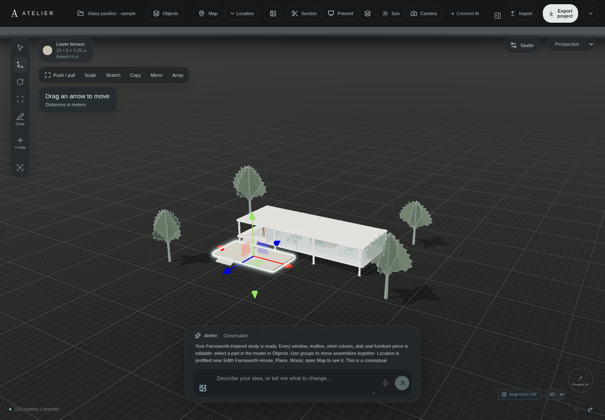

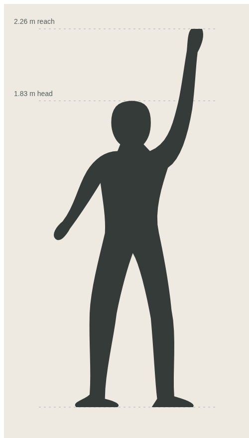

The platform corrections use inspected rectangle parameters and placements in the documented FreeCAD reconstruction, which cites primary drawings. Direct Library of Congress access was blocked (CONNECT 403); original drawing verification is still pending. Source limitations and dimensions are recorded in [the sample guide](SAMPLE-PROJECT.md#corrected-terrace-layout). The authored silhouette was visually inspected at full size; no third-party drawing or CAD geometry is redistributed.

## Object visibility — October 19, 2026

**144 unit/integration tests in 36 files pass.** New coverage exercises multi-object hiding, retained identities/geometry, cleared viewport selection with preserved conversational focus, showing that focus again, saved project/session round trips, undo, locked-layer visibility, isolated recovery from hidden groups, and actual exclusion from OBJ and AR snapshots. Invalid visibility data is rejected; older objects default to visible.

**Four production-browser scenarios pass:** desktop and phone hide/show/reload/multi-selection/show-all/undo, plus desktop and phone detailed-sample editing regressions. The viewport actually removes hidden meshes and selection glow/handles; tests also verify preserved object names/counts, no horizontal page overflow and no browser errors. TypeScript/Vite build, formatting and whitespace checks pass. The static `/atelier/` smoke passes with actual JS/CSS/WASM loading, solid rendering, editing/reload and lazy assets. Shared provider context now includes effective object visibility and the operation schema supports visibility/show_all. These are deterministic execution and browser checks, not live voice/language verification; no paid provider calls were made.

See [Hide and show objects](VISIBILITY.md) and [topography access steps](TOPOGRAPHY-RESEARCH.md#enabling-source-access-in-codex). The running cloud environment still lacks the official terrain-source domains; saving/publishing their proposed network configuration remains necessary before source verification. This does not itself install terrain support.

## Detailed house, editable components and silhouettes — October 19, 2026

**141 unit/integration tests in 35 files pass.** The sample's 133 objects all evaluate to valid positive-volume solids. Tests cover fresh identities, six editable groups, independent window edits, terrace end-face stretching, undo, session round trips and provisional site settings. Building-component tests verify actual material volume and world bounds after separating a raised, rotated building; isolated window edits; group preservation; locked-object rejection; and undo back to the procedural envelope. Native tree geometry is sparse, closed and tagged for transparency, including wrapped rotations and AR materials. The Modulor-inspired cutout's actual bounds match its stated dimensions.

**Nine targeted production-browser scenarios pass across the runs:** detailed sample opening/editing/undo/reload/project preservation; phone component search and thin-window dimensions; reviewed building separation, window resizing and persisted undo; object color/person creation/wireframe/hidden-line occlusion; map placement/failure handling; expanded shadows/mobile controls; native USDZ handoff; and shared WebXR conversation/model refresh in both themes. The final three-case component/sample run passed together. The new browser selector was corrected to use the existing accessible “Show objects” name, and slow-render animation assertions wait for completion without removing geometry assertions.

TypeScript/Vite production build, formatting and whitespace checks pass. The static `/atelier/` compatibility smoke also passes with actual JS/CSS/WASM loading, real solid rendering, direct edits/reload and lazy 3D moodboard/model assets. Desktop and phone screenshots were visually inspected. AR transport/native capability scenarios remain explicit fixtures, not physical-device tracking or microphone verification. No paid model requests were made.

**Site limitation:** the prefilled map center is provisional, not surveyed. Measured topography has not been added: official house/USGS destinations returned outbound-policy denials. The saved environment network draft requires user review/save and publication before data can be obtained and verified. No invented terrain is labeled as real.

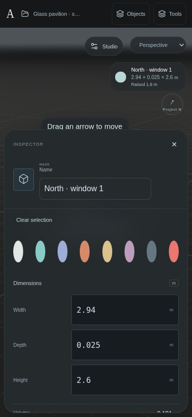

## Spatial tools, phone AR and editable sample — October 19, 2026

This update preserves the existing app/service and project formats. **138 unit/integration tests in 34 files pass**, including exact bounded map coverage/UV crops, atomic camera placement, meter-based AR fitting and invalid-input rejection, tracked-camera conversion into project axes, WebXR lifecycle/model-update fixtures, and genuine solids for all 24 objects in the new sample house. Existing provider SDK tests now carry AR workspace context. No paid requests were made.

Production Chromium checks in this turn include a passing **10-case spatial/AR regression**, followed by a passing **16-case phone/interface regression**. They exercise real geometry and interaction: 5 km map overview without scaling buildings; selection shortcuts and direct pull labels; two-click walk placement; camera placement between named objects; preservation of old extrusion and opening controls; phone tool sheets with unobscured buttons; import, drawing, inspector, projects and moodboard; formation and replacement animations; and unsupported/denied AR paths. A final **9-case production follow-up passed** for sample creation/editing/undo/reload/project preservation, both day/night AR conversation layouts, native handoff, phone modeling controls, project-save failures and the existing extrusion/opening workflows. The sample flow passed once more after the final header cleanup. These are targeted production-browser runs, not a claim that the entire GitHub Actions suite is green.

The final TypeScript/Vite build, formatting and whitespace checks pass. The static **`/atelier/` smoke test passes** with actual JS/CSS/WASM loading, solid rendering, direct editing/reload persistence and lazy moodboard/model assets. The same artifact is used by the production Node server; static Pages alone still has no AI backend.

The AR browser scenarios explicitly mock native capability detection or the WebXR transport. The actual shared conversation, request validation, geometry engine, USDZ export and AR-model rebuilding run in the browser. A separate session test uses real Three.js scene objects with fixture hit poses and a renderer double to check placement, two-point scale/rotation, updates, control-tap isolation, rejection of wall placement and cleanup. This does **not** establish real camera tracking, surface precision, microphone/camera coexistence or iPhone native rendering. iPhone Quick Look does not host ATELIER chat; it pauses voice and requires returning to the app. WebXR integration keeps the shared conversation overlay and passes AR-relative camera context, while protecting physical viewing scale from ordinary modeling dimensions.

The phone interface uses a labeled Tools menu and one bottom sheet, with larger targets and conversation hidden only while that sheet needs the space. Desktop retains movable panels. Fixes also prevent automatic Move-tool activation from cancelling construction, preserve animation stages across slow/background frames, and keep new selection styles separate from existing inspector controls.

The [sample house](SAMPLE-PROJECT.md) is a locally generated conceptual study inspired by Farnsworth House, not a measured replica or a model-provider response. The first screen offers it and Projects can create another editable copy without overwriting the current project. The [topography research](TOPOGRAPHY-RESEARCH.md) reviews official GDAL/PDAL/GeoTIFF and LiDAR catalogue sources; no terrain has been imported and no site accuracy is claimed.

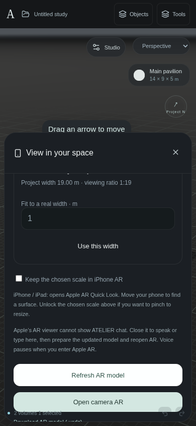

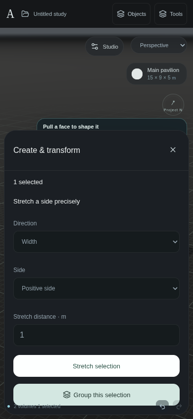

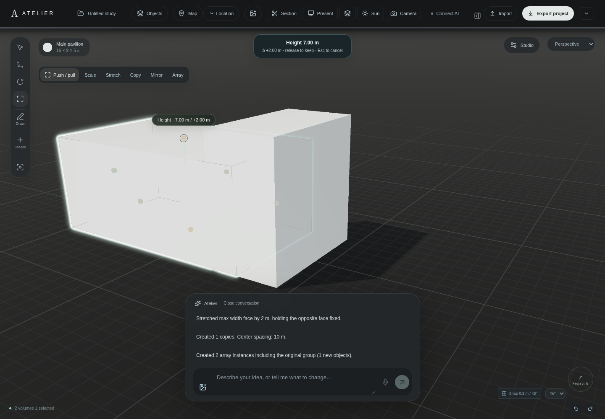

Render status is checked through its API. The public app hostname and map providers are outside this cloud environment's network allowlist, so browser checks use the actual production Node server locally and explicit map tiles. No Render service or API key is recreated.

## Interaction, spatial references and motion — October 19, 2026

See [the interaction and phone-viewing guide](INTERACTION-REFINEMENT.md). **124 unit/integration tests in 28 files pass**. Added numerical checks cover rigid multi-selection transforms with a common ground clamp, locked-member protection, map displacement under a rotated bearing, meter-based USDZ geometry/scaling, AR cancellation and unavailable-device handling, and validated moodboard snapshots/limits. The actual provider SDK contract also carries current section state.

Browser coverage includes whole-selection movement/rotation and Escape cancellation; group selection and phone additive selection; visible 2D profiles/extrusion/scale/stretch; one tool dock with sticky close controls; map dragging/nudging without moving the buildings; dark section caps and independent cut/plane switches with a real draggable plane; genuine USDZ downloads and explicit unsupported/permission-denied AR paths.

The 3D moodboard checks mix a local image, an actual model snapshot and a linked note, drag references, change depth/rotation, undo/redo, inspect exported backup contents, reload and switch projects. Borrowing a model from a saved project does not insert it into the receiving project's geometry. Save failures remain visible and unsaved board data stays exportable. Mobile layout and the shared moodboard workspace action are tested. Images/notes are not silently sent to the provider.

Motion checks exercise footprint/rise/settle, updated-geometry reveals, a genuinely pending provider request (explicit transport fixture), exact measurements during/after animation, and reduced-motion behavior. Undo/reload do not replay construction. Rendering uses actual Three.js meshes and Manifold geometry; fixtures do not establish live AI language or voice quality.

The complete **47-case production regression passed** before the section-plane/moodboard/motion follow-ups. A **19-case focused production run also passed**, covering those additions and the affected import, motion, selection, map and AR paths. Together these cover **55 distinct Chromium scenarios**. The final moodboard build then passed all four moodboard scenarios again, including animation settlement and undo history. The static `/atelier/` smoke test passed with JS/CSS/WASM and lazy map/moodboard/model assets, direct solid editing and reload persistence. TypeScript/Vite, formatting and whitespace checks pass. The suite uses software WebGL; it is functional verification rather than a hardware performance benchmark.

No paid AI calls were made. AR hardware camera tracking, Quick Look display and actual surface placement remain unverified without a compatible phone. Render deployment status is checked through its API; the public application hostname and map providers are outside the cloud network allowlist. Browser verification uses the production Node server in the cloud with explicit map fixtures. Terrain and native RVT/SKP remain outside this update.

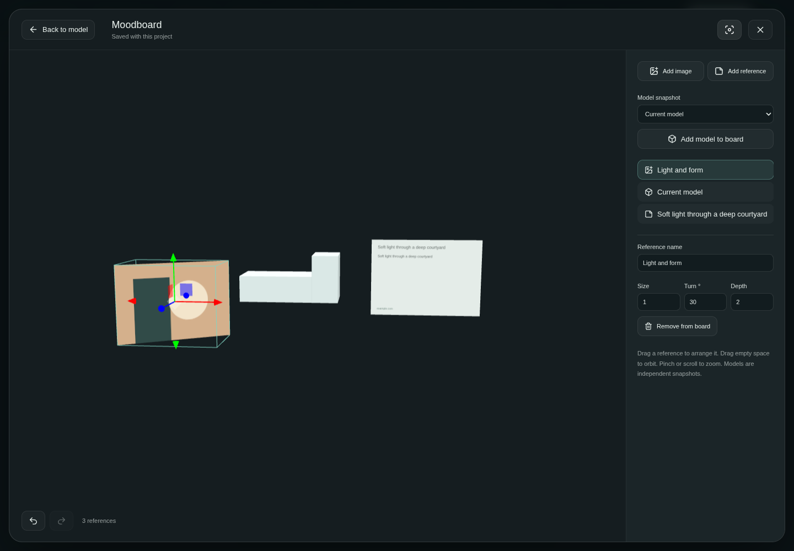

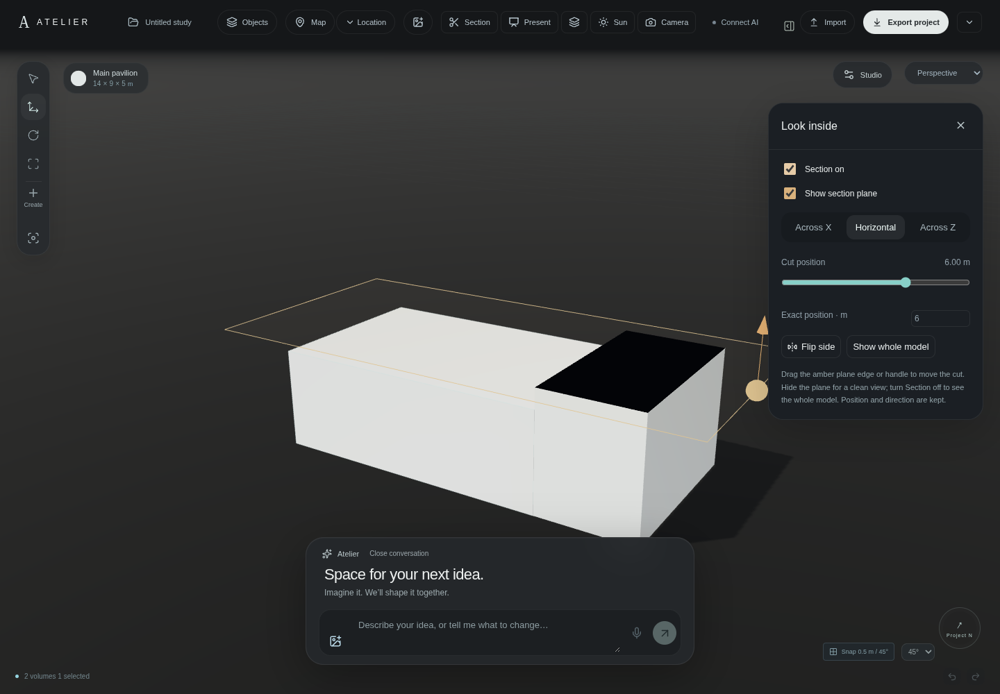

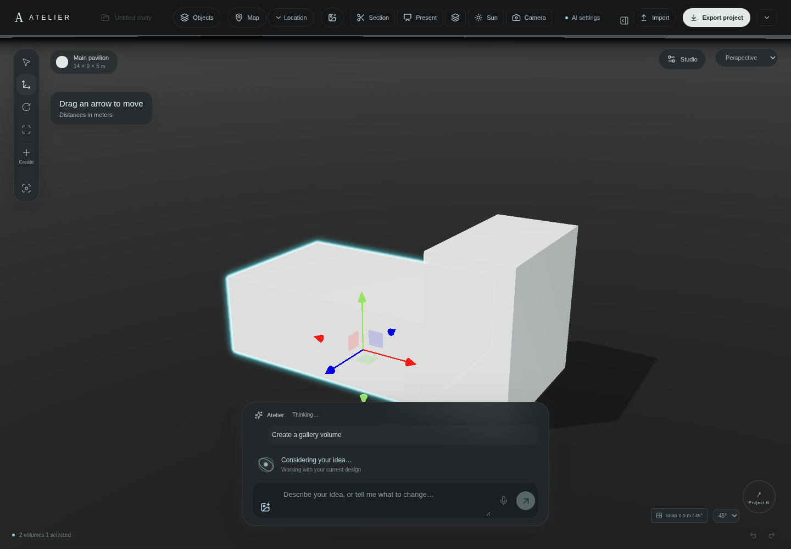

## Expressive studio — October 19, 2026

This earlier milestone is described in [the expressive studio guide](EXPRESSIVE-STUDIO.md). **112 unit/integration tests in 23 files pass**, along with TypeScript, the production Vite build, formatting and whitespace checks.

New numerical checks cover analytic loft volume and winding, closed straight/curved sweeps, rejection of a folded crossing sweep, arbitrary-axis solid rotation with stable center/identity, exact hollow-box material volume, real section-cap area with cavities, opposite-face push/pull anchoring, independently sized lower floors with reviewed lifting, fixed clear glazing widths after narrowing, locked-group protection, tree placement around a rotated envelope and avoidance of neighboring object envelopes, world-space OBJ dimensions and hidden-layer exclusion. Solar tests check equinox noon altitude/azimuth, true-north bearing rotation and explicit UTC-offset conversion. Provider tests verify real multimodal SDK payloads, strict schema, one bounded geometry-repair attempt and no automatic repeat of a billing rejection.

The 41-case production Chromium regression initially passed 37 cases. Focused reruns passed all four affected cases after fixing the late-loading map coordinate overwrite, inspector/addition overlap, presentation exit visibility and project-dialog cancellation during list refresh. The added delayed-map-loading regression brings the browser suite to 42 scenarios, all covered by passing production regression/focused runs. Final map interaction, solar/camera, image-reference and tree/group/OBJ workflows were rerun successfully. The static `/atelier/` smoke test also passes with JS/CSS/WASM and lazy map assets, real solid rendering, exact editing and reload persistence. Tests use explicit provider/map fixtures where indicated; the application has no fake AI fallback.

The browser checks exercise capped section cuts, satellite/provider switching and map-only rotation, direct face dragging, floor/glass/envelope toggles, corrected sweep/loft transactions, true solar lighting, eye-level keyboard movement, camera lens settings, marquee selection, persistent hidden/locked groups, solid trees, actual OBJ download contents, and downsampled reference photos through follow-up and reload. Existing projects, original Boolean success sequence, imports, direct transforms, mobile layout and voice transport contracts remain covered.

No paid text, image or voice requests were made. Live language/image interpretation, audible voice quality and satellite imagery availability are not claimed verified. The public Render hostname is outside this cloud environment's network allowlist; deployment status is checked through the authorized Render API, while actual browser tests run against the production Node server in the cloud.

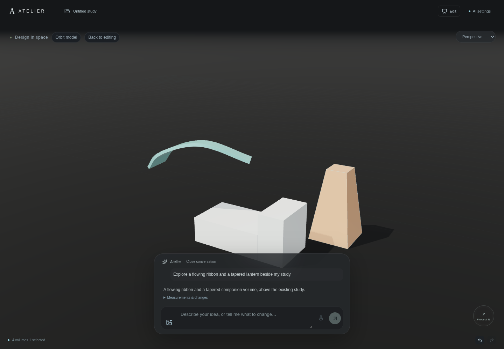

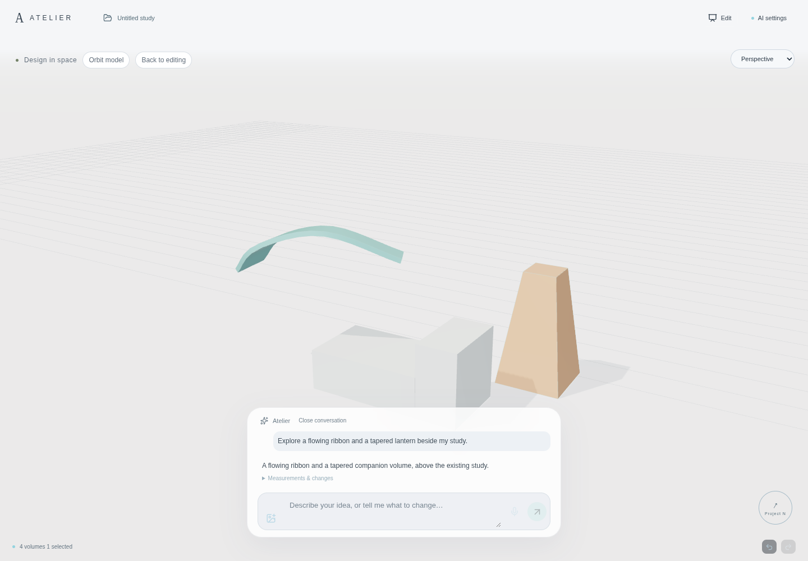

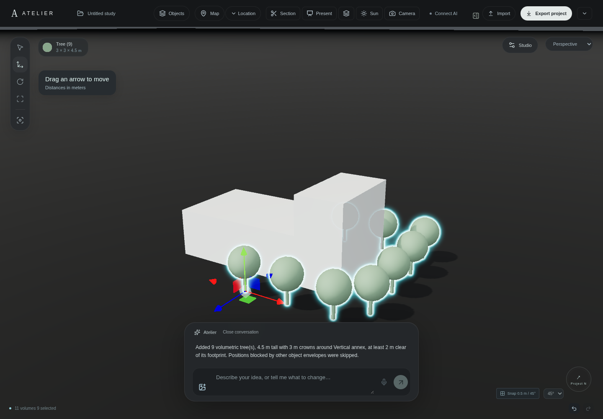

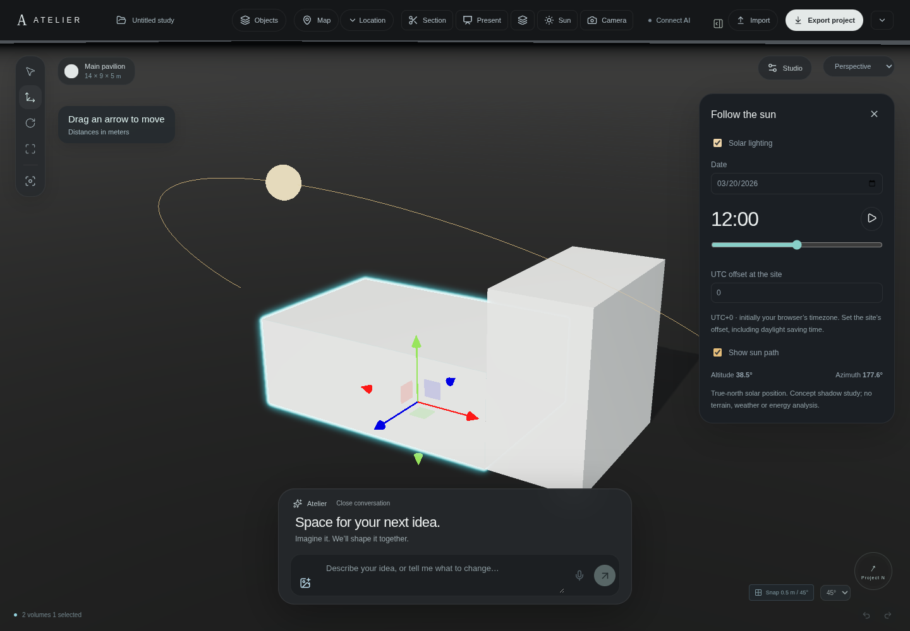

## Earlier validation milestones

- **89 unit/integration tests** across model compatibility, structured plan validation, camera-relative directions, engine execution, Manifold geometry, history persistence, mesh imports, motion timing, API access protection and actual SDK request/response contracts. Hosting checks verify trusted HTTPS origin configuration behind a proxy, secure login cookies, foreign-origin rejection and authenticated voice-session routing using an explicit provider double. Provider error tests verify actionable billing/key/configuration messages without exposing upstream errors.
- **33 Chromium scenarios against the production Node server**, covered by the regression suite and focused reruns: rendering/orbit/top view, collapsible inspector, legacy-data preservation, exact editing, profiles/extrusion, raycast selection, conversational UI execution using explicit model-response fixtures, destructive review/stale-plan protection, export/import, translation handles, missing-credential behavior, editable wall openings through reload and undo, session-import timeline preservation, OBJ/STL/GLB imports, reference surfaces, creation motion, reduced-motion and storage-budget protection. The suite also requests the real `/healthz`, `/api/config` and `/api/plan` routes to verify the combined server and honest missing-key behavior.
- **TypeScript check and production build**, including the packaged Manifold WASM asset.
- **Static Pages smoke test** at `/atelier/`: JS/CSS/WASM paths, actual mesh rendering, direct exact editing, reload persistence and honest disconnected AI/disabled voice state. The expected unavailable `/api/config` endpoint on a static site is explicitly distinguished from failed asset requests.
- **Application-server startup:** both development and production services returned ATELIER HTML and `/api/config`. Without a credential, `/api/config` reported `configured:false` and `voiceConfigured:false`; `/api/plan` returned HTTP 503 with a configuration explanation.
- Formatting and Git whitespace checks passed.

## Numerically verified geometric operations

- Boxes, tessellated spheres/cylinders, rectangle/circle profiles and extrusion.
- Union, subtraction and intersection with known volumes; closed mesh edge incidence; Manifold `NoError` status.
- Empty intersections/non-intersecting cuts rejected without losing operands.
- Stable first-operand identity and preserved recursive operand recipes.
- World and camera-relative transforms, approximate resizing, duplication/arrays, clear-gap spacing, base-center alignment and overlap placement.
- Real openings through walls, editable cutter width/height (including rotated and nonuniformly scaled results), and measured solid-volume changes.
- Undo/redo through serialization and restoration, including Boolean operand identity.

The requested sequence—create two boxes, move the second right, make it taller, overlap, subtract, undo and intersect, then widen the result—passed at the **structured-operation and UI-contract levels**. The UI test supplies known model-response fixtures; the production app itself has no such fixture fallback. Manifold produces the real resulting geometry. The final intersection volume changes from 288 m³ to 316.8 m³ after widening by 10%.

## Raised-pavilion milestone — October 16, 2026

The complete new sequence passed numerical tests: 100 × 20 × 8 m upper envelope with y=4; a 106 × 26 × 4 m outward-offset base; 45° upper rotation; centered cylinder of radius 4 m/height 12 m; genuine shared-solid intersection; two occupied floor slabs plus a roof with closed glass/frame solids. The cylinder intersection is approximately 401.48 m³ before the architectural conversion. The final envelope still spans y=4 through y=12, and the original upper ID survives.

Additional checks cover a full rectangular facade, editable floor count without nesting recipes, exact sphere-on-base placement for different heights, ambiguous names, unsupported sloping facades, invalid below-ground bases, positive component volumes, Manifold status and serialization/undo. Both sample projects are generated through this same engine.

The expanded browser suite checks the full-size canvas, hidden-by-default panels, mesh reuse on selection, direct shape creation, narrow-screen panel/import/export access, actual facade rendering, reload and floor-edit history. Another explicit model-fixture test executes cylinder intersection, conversational cancellation/approval, architectural conversion, rejection of approval without a pending review, and undo restoring the raised rotated envelope. These fixtures test application execution, not the provider's interpretation of the user's sentences.

Voice lifecycle tests use explicit media/transport doubles: repeated turns and spoken confirmation route through the same callback, duplicate tool events do not duplicate edits, cancellation before microphone permission is granted does not open a provider session, and rejection/stopping release microphone tracks. They do not certify audio quality or live turn-taking.

The configured Render key was checked again during this milestone; OpenAI returned HTTP 429 `credit_balance_exhausted`. No successful live plan or spoken session is claimed. The existing service/key are preserved; no terrain work was started.

## Conversation-first interaction

A separate browser test uses explicit model responses to ask about a floating gallery, accept a short answer using prior dimensions, create it, and apply a subsequent depth correction through conversational focus. No primitive selector or manual selection is used. It verifies that clarification leaves the project unchanged, Enter/Shift+Enter behave correctly, an in-flight request preserves the user's next draft, actual measurements remain available, and dialogue survives reload. Default UI checks verify that primitive and architectural action buttons are absent from the main scene while optional manual tools remain functional. These are dialogue/execution contract checks, not proof of live model quality.

## Grounded assistant milestone — October 16, 2026

No paid model or voice requests were made for this milestone. The checks below exercise actual geometry and explicitly supplied model/voice transport responses; they do not certify live language understanding.

- Custom concave footprints: a 50 m² L outline extrudes into 250 m³ of solid, has closed mesh edge incidence and retains its asymmetric orientation. Flat profiles measure area before extrusion. Resize doubles material volume, stable identity survives persistence/undo, and real courtyard cuts and floor slabs operate on the custom outline.
- Boundary checks reject crossing, repeated, degenerate or incorrectly normalized imported polygons atomically. Resizing an offset opening cannot breach the wall's outer edge.
- Read-only queries return known material volume, surface area, elevations, center distance and shared solid volume without altering geometry, selection, focus or undo/redo. Bounding-envelope gaps are explicitly labeled, never claimed as exact nearest-surface distances.
- Group yaw preserves layout/elevations around a common center or reference. Mixed-size approximate moves and arrays use a common offset. Roof alignment accounts for different object heights; below-ground results are rejected. Oblique-view spacing uses the oriented projection. “Spread more” increases the existing gap; duplicate names stay distinct.
- Browser checks create a flat L footprint through an explicit plan fixture, extrude it, ask a measured question, reject an oversized cut before review, inspect a validated floor conversion, approve it conversationally, undo, measure again and reload. An intentionally invented numerical summary is suppressed in favor of the measured engine result. The exact proposed operations/outcome and undo counts reach the next planner request. Existing review/cancellation/stale-scene, original success sequence and precision-tool checks remain in the regression suite.
- Voice transport doubles verify queued follow-ups run in order, stopping discards queued requests, five idle minutes release capture, and active state is separate from disconnect/idle messages. This does not verify audible quality or live barge-in.

The browser regression run passed 15 cases; its former stale-review fixture requested a non-intersecting cut, now correctly rejected before review. After changing that fixture to overlapping solids, the affected stale-review, custom-footprint and wall-opening cases all passed on the final build. All 16 distinct browser cases are covered.

The full saved conversation (up to 80 messages) is scrollable; the last 20 bounded messages are sent as model history. Newly generated/resized solids are checked before an atomic commit. Destructive reviews store a checked candidate result and require an unchanged session before installation.

## Studio and mesh import milestone — October 16, 2026

OBJ cube import measures 24 m³ and a genuine subtraction leaves 12 m³. ASCII/binary STL tests cover units and Z-up conversion. Embedded GLB tests bake mirrored transforms while preserving closed topology. External buffers, invalid geometry and unsupported GPU instancing are rejected; external texture URLs are stripped without a network request. Open OBJ triangles render as references, remain transformable and persist through undo; their solid volume is explicitly unavailable. Planner context includes reference status while excluding vertex/index arrays, and passes the actual server request schema.

The browser tests use real file inputs and a file-drop event. They verify existing objects are unchanged, dimensions/solid volume survive reload, import is undoable, file-unit choices work, bad imports are atomic, references remain editable, and the import dialog fits a 390-pixel viewport. A history-bearing session above the conservative import save budget rejects an additional mesh without changing the saved session. That fixture stays within the supported 50-snapshot history limit.

Construction tests observe footprint/extrusion/completion phases and verify that final dimensions and undo counts never contain intermediate animation values. Restore and reduced-motion checks show final geometry without replaying creation. A pixel-level browser check verifies that Outline actually darkens surface interiors while leaving the model unchanged. Visual inspection found that toggling Three.js transparency needed a shader refresh; this was fixed and the pixel check passed. Screenshots were inspected from the actual application, not generated mockups.

The local full browser regression passed 20 of 21 cases initially. Its export/import test used Playwright's extensionless temporary download path, which the new format-aware importer correctly rejected. The fixture now uses the real exported `.json` filename. The corrected JSON case and the five initial import/motion cases passed on the final application build; the additional storage-budget case then passed separately. Together these cover all 22 current scenarios. No paid provider request was made.

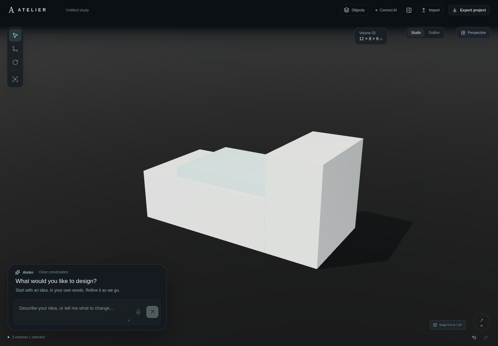

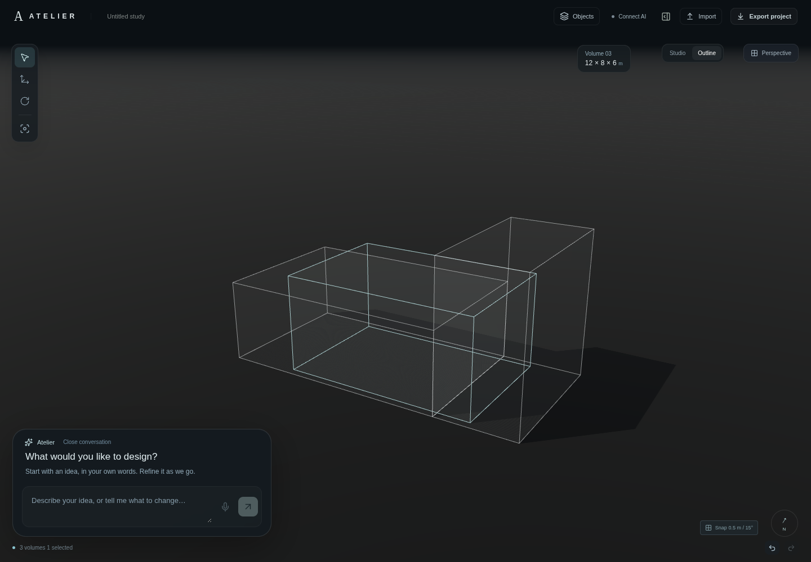

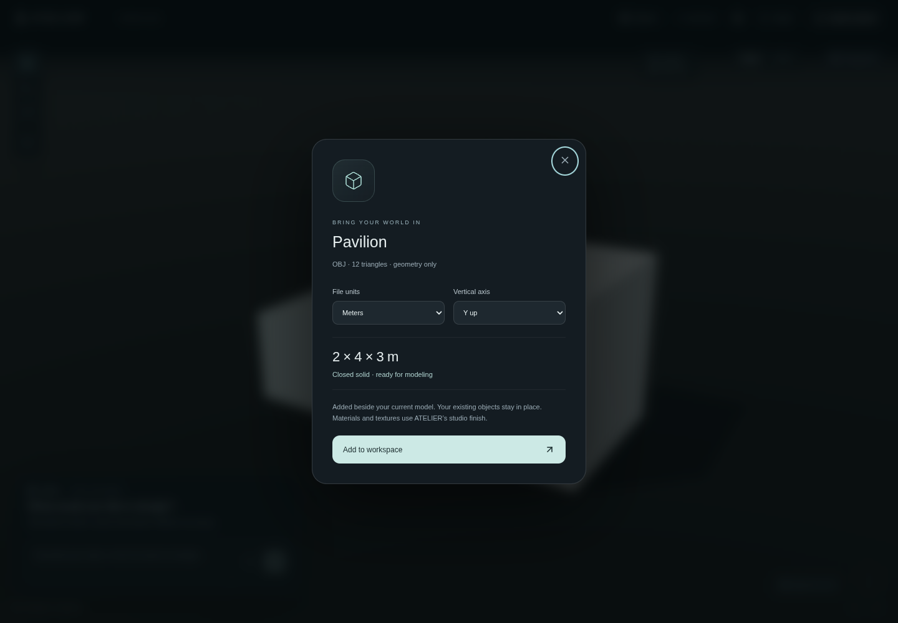

See the [requirement audit](PHASE2-AUDIT.md) for the complete original Phase 2 checklist and remaining roadmap work.

## Refined studio, appearance and modeling vocabulary

The full production-browser suite passed all 25 scenarios in 6.2 minutes locally. The unit/integration suite passed all 85 tests.

New numerical checks cover object-color persistence and undo, exact 1.75 m person geometry, uniform group scaling (including slab/frame material volume), rotated rectangular end-face stretching, asymmetric solid reflection and reversal, mirrored glass/frame render parts, grid/polar arrays, scene limits, geographic coordinate scale and preservation of map anchors through manual creation.

New Chromium checks exercise real color controls, scale-person creation, persistent display preferences, the 600 m move that previously outgrew shadow coverage, narrow-screen controls, and location persistence. Pixel comparisons verify that hidden-line rendering occludes rear edges and that chosen surface colors change the actual canvas. OpenStreetMap tile success/failure tests use explicit image fixtures, bounded to nine requests, with visible attribution and unchanged model geometry. They are not a live imagery availability test.

The first focused browser run found that a decorative diamond polluted the accessible names of view-style buttons. Marking that decoration aria-hidden fixed the controls; both affected cases then passed, including the actual hidden-line pixel assertions. A separate layout inspection caught and fixed a doubled header offset. Screenshots below are from a real demonstration project rendered by the application, created through structured geometric operations; they are not evidence of a live AI request.

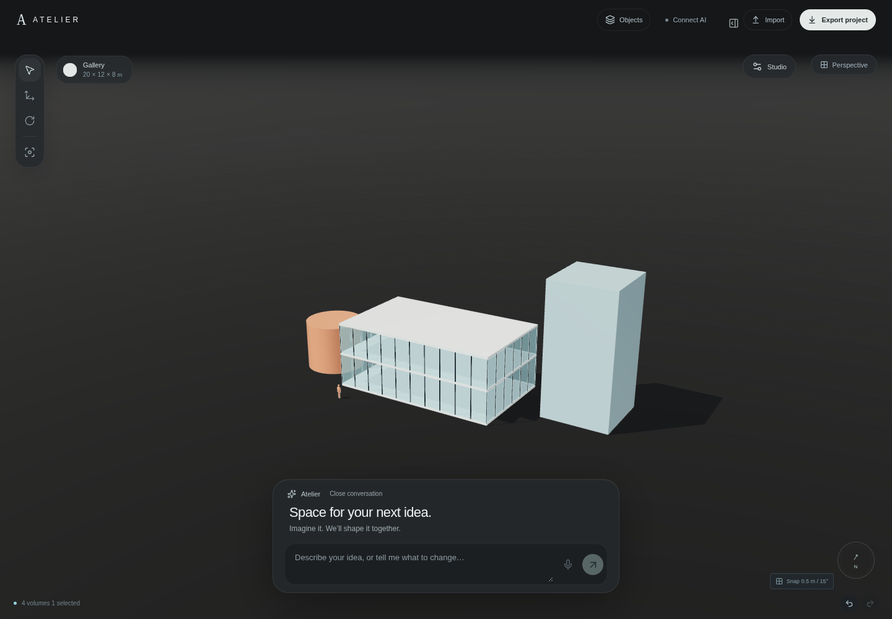

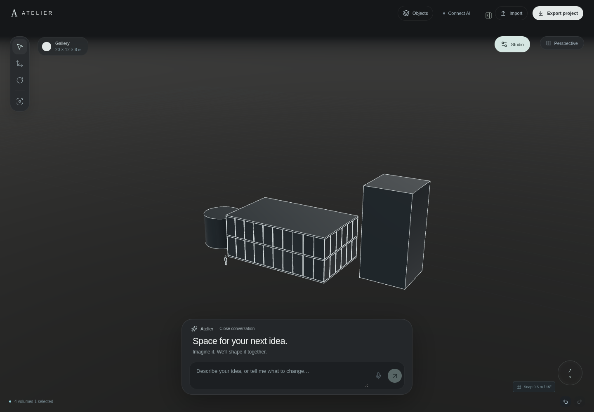

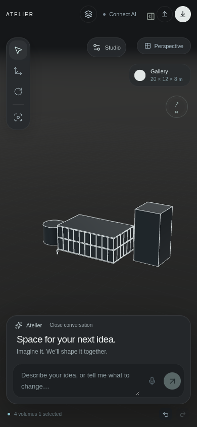

See [the studio guide](STUDIO-UPDATE.md) for supported operation meanings, map setup and remaining limits.

## Not verified live

During initial setup, `npm run test:live-ai` exited **2**, explicitly reporting that `ATELIER_OPENAI_API_KEY` was absent. These tests do **not** establish arbitrary language understanding, live pronoun/spatial disambiguation quality, or bilingual quality. See the subsequent live API diagnosis below.

Realtime SDP/tool configuration was tested through the real SDK using a test transport. This does **not** verify a live provider call, real microphone capture, audible response, continuous turn-taking, interruptions or browser media connectivity. Those checks require a configured provider account, HTTPS and a real microphone/browser session.

Required next action for the existing installation: fund the OpenAI API account/project associated with the stored key, then run the live text check and perform the spoken success sequence in an HTTPS browser. A new key or Render service is not required just to update the application. The live script stops for clarification rather than treating ambiguity as a pass. No secret should be provided in chat or placed in frontend code.

## Inspected screenshots

Custom-footprint slabs, produced by the real solid engine from an explicit test plan:

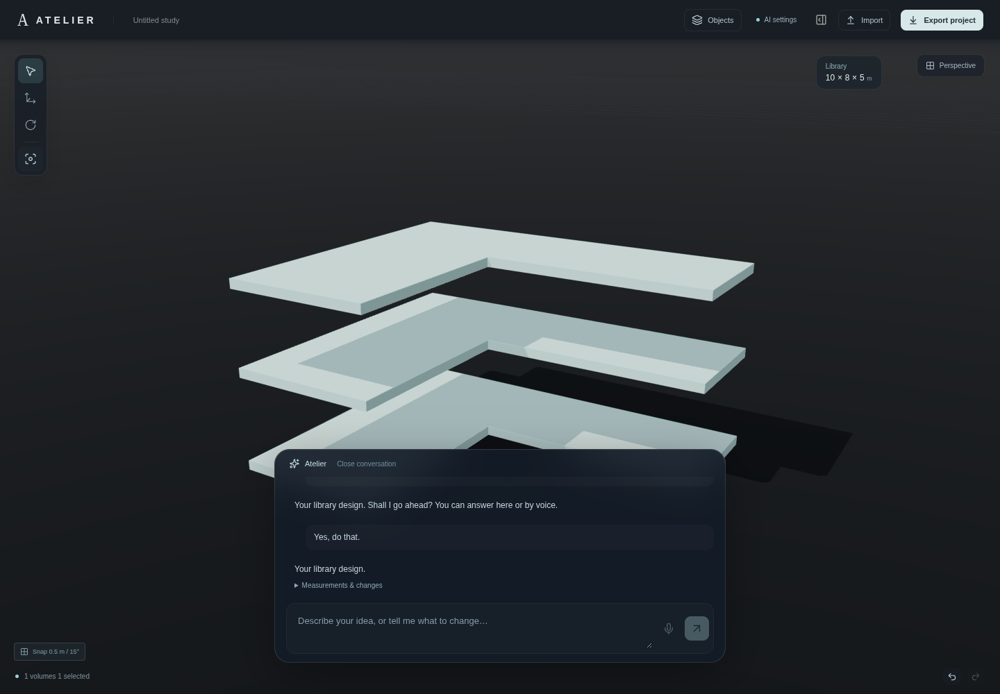

Conversation without primitive selection:

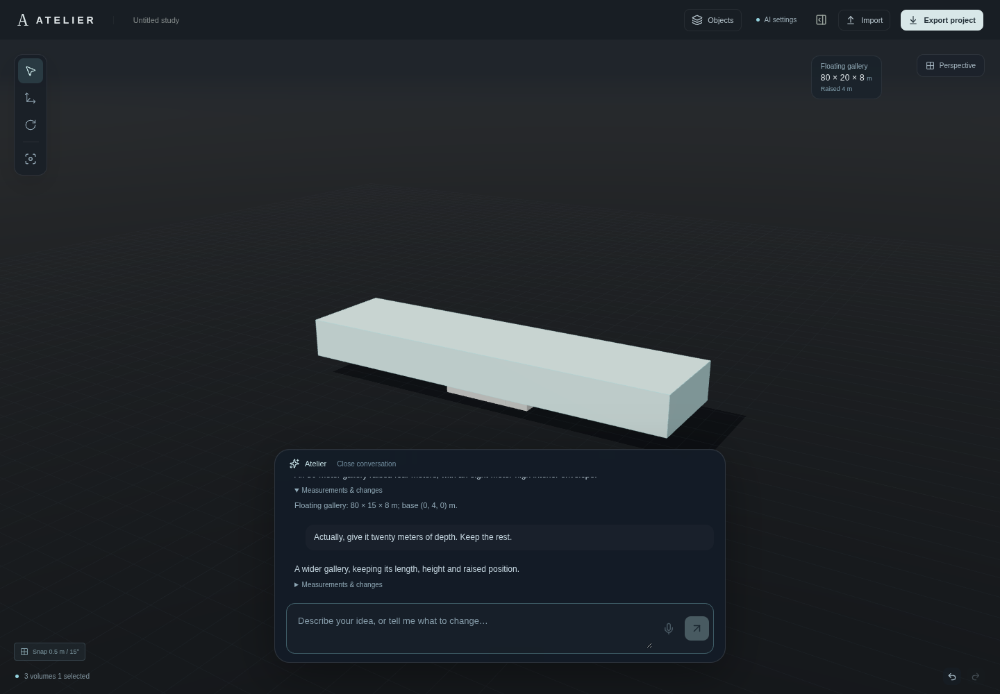

The immersive production workspace:

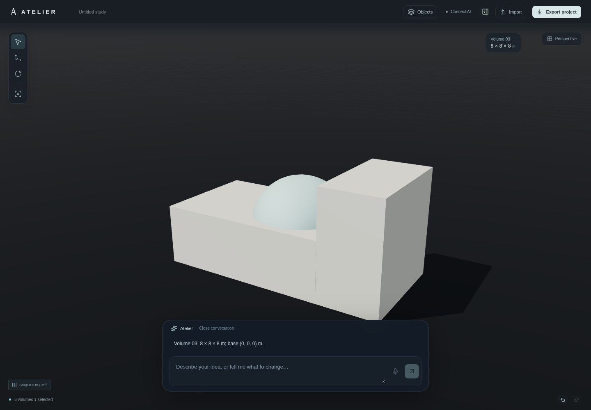

The raised, rotated pavilion with real floor/glass/frame solids:

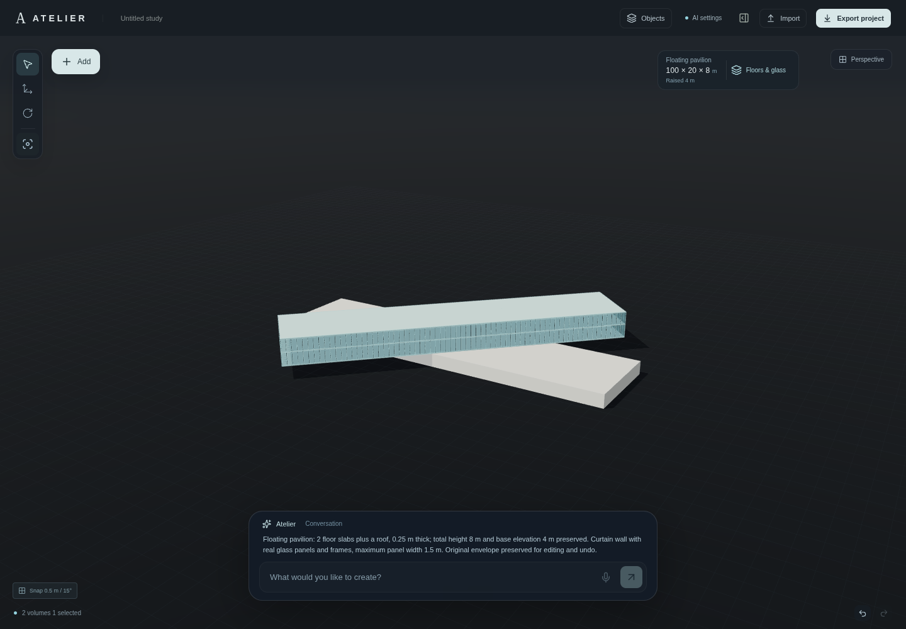

Narrow-screen layout checked in Chromium (this does not certify Safari or real touch hardware):

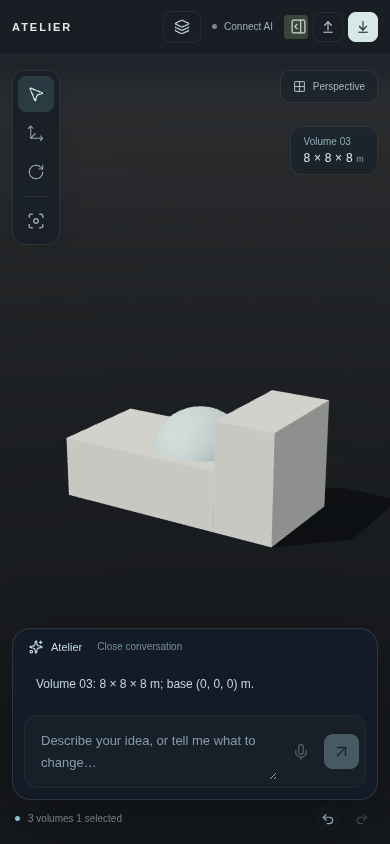

A genuine Manifold wall cut with editable opening dimensions:

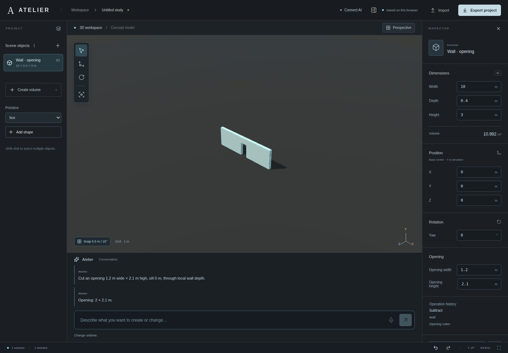

## Practical limits

Vite builds successfully with its size advisory (approximately 1.16 MB application JavaScript before compression, 320 kB compressed, plus approximately 541 kB WASM). Manifold's conditional Node-only module is externalized in the browser build; the production browser tests exercised the browser path successfully. Large-model performance, Safari/mobile behavior, multi-user hosting and exact analytic CAD/BIM exports are not certified. Terrain/site workflows remain on the roadmap.

### Dense-import navigation — October 20, 2026

The performance follow-up passes **170 unit/integration tests in 45 files** and
**10 distinct targeted production-browser scenarios** across regression and
focused reruns. Coverage includes binary Revit FBX editing/undo/reload, a
million-face full-detail import, optional reduction, 201 MB cancellation,
studio colors/hidden lines/maps/shadows, and persistent viewing-quality controls.
The final focused run covers the final import framing and save-encoding changes.
The static `/atelier/` production smoke also passes, including lazy imports,
real Revit FBX worker/WASM loading, direct edits and reload persistence.

The genuine **1,065,800-triangle** facade keeps every face after saving and
reopening. Its responsive display retains about **534,000 vertices**, versus
3,197,400 vertices for that facade in the previous deindexed rendering path
(approximately 83% fewer). Browser checks verify that idle GPU submissions stop
and a real orbit gesture resumes rendering without remeshing. Accelerated
raycasting tests compare hit positions and face indices with Three's original
raycaster and verify unchanged indices/positions. Selection, wireframe, section
caps and quality preferences work in the responsive mode.

Visual inspection of the running model exposed an import-framing issue: the
old close-up creation limit could put the camera inside a larger import. Imports
now fit their actual extent while ordinary volume creation retains its close-up
behavior. Dense imports skip the expensive transparent formation fade; ordinary
creation animation remains available.

This is a rendering-work reduction, **not a measured FPS guarantee**. Tests use
software-rendered Chromium, not the user's computer or physical iPhone. The
user's specific laggy FBX was not supplied. High-capacity import acceptance does
not guarantee smooth navigation at five million triangles on every device.
Smooth navigation changes display lighting, resolution and selection effects;
it does not simplify saved/exported geometry. No paid AI requests were needed.

Local test results alone do not establish a public deployment, GitHub Actions execution, new cloud snapshot or live AI/voice session. The existing Phase 1 `main` branch is preserved while Phase 2 is prepared on its feature branch.

The Render blueprint and [browser-only activation guide](HOSTING.md) are in the repository. During initial setup Render account access and an OpenAI key were absent. Subsequent authorized Render API access confirmed deployment of commit `28f8541` as `live` at https://atelier-emxi.onrender.com. This establishes deployment, not successful AI/audio behavior. The reusable Codex startup instructions were saved as a draft; that save does not publish the application.

## Live API diagnosis — October 16, 2026

The user's sphere-on-prism request was reproduced against OpenAI with the deployed service's credential, used only in memory without printing or persisting it. The API rejected the generated schema with HTTP 400, `invalid_json_schema`: `oneOf` is not permitted at `operations.items`. Zod's discriminated union emitted that unsupported keyword; fixture responses had not enforced this provider restriction.

The wire schema now uses `anyOf` for the operation union. Unique literal `type` values keep its branches mutually exclusive, and the original strict Zod validator and geometry constraints are unchanged. The SDK contract test checks the actual serialized request for the supported union, distinct types and strict required fields.

After this correction, live requests for “Create two boxes” and the original sphere-on-prism instruction returned HTTP 429, `credit_balance_exhausted`, stating that API credits must be added. No model plan or new geometry was produced. Billing must be resolved before live modeling or voice can be verified. The backend now reports recognized billing, authentication and schema errors using fixed safe messages instead of exposing raw upstream errors or hiding every cause behind the generic plan failure.

## Projects and direct interaction — October 16, 2026

The unit suite passed **89 tests across 15 files**. The complete browser run passed 32 of 33 scenarios; the remaining map test read storage before asynchronous project startup finished. It now waits for the rendered workspace. That map test and both project tests passed against the final production build, including the final modal keyboard safeguards. All 33 distinct browser scenarios are covered by the regression and focused reruns. TypeScript/build, formatting, Git whitespace checks and the final static `/atelier/` smoke test passed.

- Projects migrate the existing workspace, create independent blank spaces, rename, switch, and restore the active space after reload. Browser checks compare complete saved sessions and conversations, including independent site locations, undo and redo. A forced IndexedDB write failure leaves the current workspace and identity intact. Keyboard undo/Escape in the project dialog cannot edit the underlying model. Desktop and 390-pixel project menus were inspected.
- Day/Night changes actual scene and interface colors without changing project data. Screenshot pixel checks verify the rendered difference. Selection outlines are visible, and actual clicks/model-response selection activate move handles.
- Real pointer drags exercise translation distance, displacement and 45°/90° yaw snapping. Rotation uses pointer intersection with the horizontal plane, including a true orthographic overhead camera. Completed drags preserve undo semantics.
- Inspector close/clear-selection are separate; panels move with pointer/keyboard and remain inside resized windows. Object names persist; blank edits restore the previous name. Sphere meridians/parallels and cylinder generators are numerically checked against their surfaces and visually inspected.
- Map display hides the competing ground/grid and restores them when hidden. Two settled rendered frames remain stable within a bounded pixel-difference tolerance. Header toggling, geographic anchoring, attribution, tile failure messages, pan/zoom/click selection, coordinate entry and explicit geolocation fixtures passed. Picker browsing does not commit location until applied.
- Explicit model-response fixtures switch real perspective/orthographic camera classes, overhead view, Day/Night and map controls. Workspace-only plans preserve geometry, undo/redo and modeling references; invalid combined geometry requests do not partially apply view changes. Provider-bound workspace context is schema-validated.
- The static Pages smoke test also loads the lazy Leaflet JavaScript/CSS under `/atelier/`, renders geometry and restores edits; it honestly reports the absent AI backend.

Screenshots in the [studio guide](STUDIO-UPDATE.md) come from the running application. OSM image tiles and device location use explicit test fixtures: live imagery and physical GPS were not verified through this cloud network. No paid model or live voice calls were made. The public Render application hostname is outside this environment's network allowlist, so browser verification uses the production Node app locally; Render deployment status must be checked separately through its API. Existing service credentials and hosting configuration are unchanged.

The first GitHub PR run on `d974a86` passed 31/33 scenarios. Its two failures were test time budgets: the seven-edit CSG sequence exceeded the default 30-second total, and a separate case exceeded the five-second initial workspace wait. The sequence now allows 90 seconds, checked-review testing 60 seconds, and initial IndexedDB/WASM/WebGL startup 20 seconds. All exact geometry/history assertions remain. Both affected scenarios passed again against the same production application (24.7 s and 14.9 s locally). This follow-up changes tests/documentation only; it does not alter the deployed application.

The parallel push run also reached all color/hidden-line assertions before its final screenshot exceeded that scenario’s 60-second total; that multi-style/reload scenario now allows 120 seconds. Its CSG sequence likewise reached the final screenshot before timing out, confirming the numerical assertions had completed. These are explicit software-rendering test budgets, not relaxed geometric tolerances or skipped checks.

### Direct 2D drawing and spatial presentation (October 19 follow-up)

- Added geometry tests for reversed rectangle corners/elevation, shared-engine extrusion and undo, concave profile placement/volume, circle radius, invalid/crossing face rejection, and adaptive grid coverage. 128 tests across 29 files passed before browser verification.
- Production browser scenarios exercise actual canvas clicks → snapped face → handle extrusion → undo; exact circle entry; closed concave outline; rejected crossing outline; cancellation without history changes; creation-only camera framing and its no-zoom-out bound; grid coverage at wide zoom; and phone touch drawing activated by an explicitly mocked structured AI workspace action.
- No live OpenAI or microphone session is represented by those provider fixtures. Manual drawing and geometric validation do not require an API key. Paid language/voice requests continue to use the configured backend.

The preceding GitHub full-suite run (`39301264668`) completed with 54/55 browser tests passing. Its sole failure was an obsolete exact-text locator for the processing label after that label gained a subtitle. The dialogue test now asserts the actual stage container, while retaining the held provider response and checks that a second draft is preserved. It is included in follow-up browser verification.

Follow-up checks passed: a 23-scenario production regression; eight focused scenarios after drawing/grid/mobile refinements (including the repaired dialogue test); three targeted rendering scenarios after the wide-view floor fade; and four formation/reduced-motion scenarios after adding reversible context softening. These runs cover 24 distinct browser scenarios. The final floor/grid ordering was checked again against both formation scenarios. The production `/atelier/` static smoke test also passed. Browser screenshots are stored as `docs/atelier-direct-drawing.png`, `docs/atelier-drawing-phone.png`, and `docs/atelier-spatial-creation.png`. Public Render checks use deployment API status because the public app hostname is outside the cloud network allowlist.
