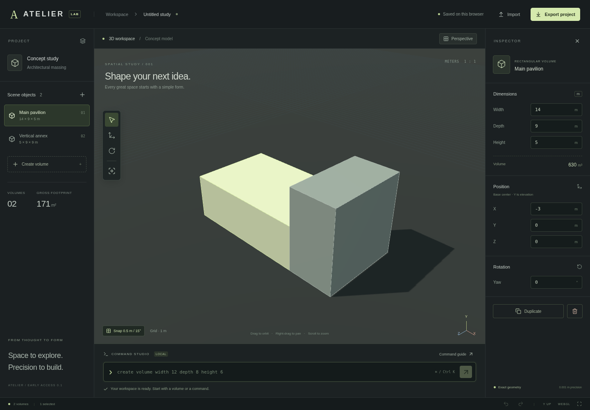

# Validation evidence

Validated in the Codex Cloud Linux environment with Node.js 24.19.0 and Chromium 154, using software WebGL.

- `bash scripts/cloud-setup.sh`: installed locked dependencies, passed model tests, and produced the application build.
- `ATELIER_TEST_PRODUCTION=1 npm run check`: passed all **18 unit tests** and **6 real-browser tests**, with a successful TypeScript check and Vite production build.
- Browser checks exercised actual rendering, orbit and top-view changes, raycast selection, snapped translation-handle dragging, exact dimensions and positions, command validation, undo/redo, reload persistence, and JSON export/import.
- The rendering test recorded no uncaught browser exceptions. The generated desktop screenshot was visually inspected.
- `npm run format:check` and `git diff --check` passed.
- `bash scripts/cloud-start.sh` started the development application on port 5173. Local HTTP checks confirmed the ATELIER page and React entry module.

This validates the current cloud instance and production bundle. It does not establish a GitHub Pages deployment, a published cloud snapshot, or cross-browser certification. The GitHub Actions workflows have been prepared but have not been run on GitHub. The first version uses a local command parser, not remote AI inference.

Vite reports a bundle-size advisory: the main bundle, including Three.js, is about 837 kB before compression (224 kB gzip). The build succeeds. Future delivery optimization can split the renderer or load it on demand.
