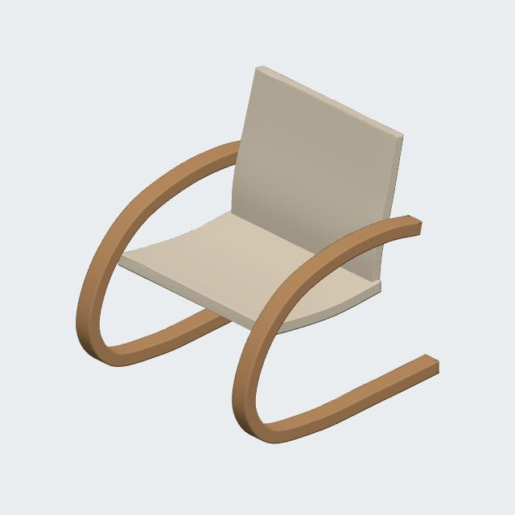
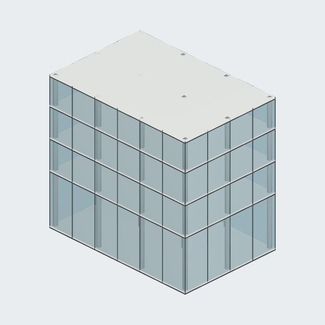
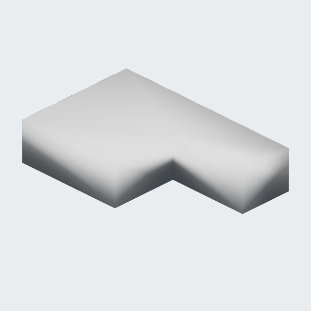

# Actual agent-generated studies

These are retained outputs from paid Responses API calls to `gpt-6.1-sol`, with high reasoning effort. The model received the real scene, execution feedback and two rendered study views. The geometry files have not been manually redesigned. Import a `.atelier.json` file using **Projects → Open project copy**; this creates an independent project.

| Study                                               | Request and measured outcome                                                                                                                                                                                                                                                                |
| --------------------------------------------------- | ------------------------------------------------------------------------------------------------------------------------------------------------------------------------------------------------------------------------------------------------------------------------------------------- |
| [Reading chair](Reading-chair.atelier.json)         | A sculptural lounge chair with two curved timber supports, seat and inclined backrest; then make the backrest more upright. Four independent parts. The second instruction preserved both supports, the seat, object IDs and backrest width. Backrest depth decreased and height increased. |
| [Four-storey study](Four-storey-study.atelier.json) | An 18 × 12 m building with a 6 m ground floor, three 3.5 m upper floors, separate slabs, roof, columns and glazing; then inset the columns by 1 m. 153 parts, including 48 columns. Slab bases are 0, 6, 9.5 and 13 m. Every non-column part was preserved exactly.                         |
| [Drawing mass](Drawing-mass.atelier.json)           | Reconstruct the unfamiliar [plan and section](reference.png), without repeating its dimensions in the instruction. One editable L-shaped footprint, 14 × 9 × 3 m, with a 6 × 5 m missing corner. Solid volume is 288 m³.                                                                    |







These images are neutral renderer observations of actual geometry, not image-generation illustrations. The building image precedes the column inset; the downloadable project contains the corrected layout.

## What failed and changed

- The chair initially attempted a self-intersecting closed sweep. Execution rejected it; the agent recovered using gentler open curves. Its first upright-backrest correction was then stopped by an unnecessary review requirement. After allowing reversible identity-preserving agent edits, a fresh paid follow-up completed.
- Building creation completed. The first follow-up attempt was stopped by the evaluator's conservative cost reservation, surfaced by the SDK as a connection error. It was resumed within the authorized ceiling; all correction checks passed. The evaluator now reports its budget stop explicitly.
- Earlier GPT-4.1 array trials invented IDs and collapsed object positions. They failed. A later GPT-6.1-Sol run correctly created 63 cubes and changed only the northern row. Those older raw artifacts were lost during a runtime interruption; they are not represented as reproducible evidence here. Tool contracts changed between trials, so this was not a controlled model comparison.

## Recheck without spending API credit

From the repository, run:

```sh
node --import tsx scripts/validate-agent-artifacts.ts
```

This imports all three project copies, validates every solid, checks dimensions and compares retained baseline hashes for unchanged chair/building parts. `baseline.json` records the pre-correction identities and hashes; `checks.json` records the before/after column bounds. `evaluation-summary.json` retains failed attempts alongside completed runs.

Estimated cumulative generation cost: **$2.80945**, including a conservative $1.25 carried forward after lost logs. This uses indicative token prices, ignores cache discounts and is not verified account billing. No additional paid tests were run after the drawing case.

Creation took about 167 seconds for the chair, 82 seconds for the building and 22 seconds for the simple reference mass. Successful follow-ups took about 46–49 seconds. These are individual observations, not latency guarantees.

## Limits

This is evidence for a small working agent, not unrestricted architectural intelligence. It does not establish structural adequacy, construction detailing, complex drawing reconstruction, exact reproduction of famous buildings, real microphone reliability, or performance with heavy imported models. The building has no circulation design because none was requested. The chair is conceptual geometry, not verified joinery. The reference is deliberately simple and legible. There is no automatic internet reference search. No Astra generation comparison was performed.

The new agent remains opt-in and has not been deployed to production. Local phone-layout tests use simulated voice transport; they exercise the real modeling and follow-up paths, but do not test live speech recognition.
