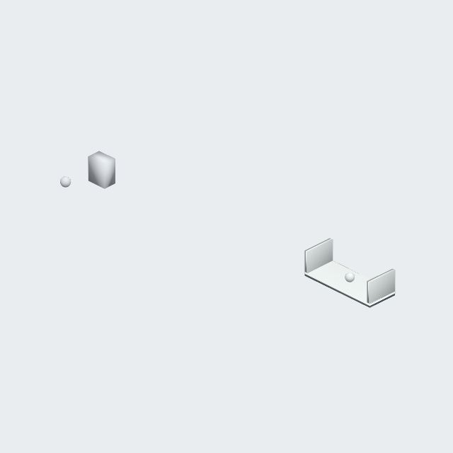

# PR #22 final checkpoint evaluation — hold release

**Recommendation: do not merge or deploy yet.** The real agent built the requested assembly correctly, and the new verifier accepted equivalent representations. A subsequent free audit of the **actual AI-generated criteria** exposed a false-acceptance defect: stretching the requested ball into an ellipsoid still produced `verified` and `canCommit: true`. Paid testing stopped; five planned turns remain unrun.

**Additional estimated API cost: US$0.088336 of the authorized US$5 ceiling.** Three requests, all real `gpt-6.1-sol`, standard tier. No additional paid retries, application changes, merge or deployment. The budget was not exhausted.

## Frozen setup

- Application: PR #22 at `a2fd752693c4b98bc322cbeae8f7ec0ebc15c866`, unchanged throughout.
- Original evaluation harness and prompts: [`54bcd04`](https://github.com/rmoralesp432/atelier/commit/54bcd04), committed before generation. See the [six-turn plan](../2026-11-18-completion-final-plan.md).
- Production modeling provider, agent, geometry engine, independent reader, verifier and browser-rendered observations. No scripted AI answers or external-oracle repair hints.
- High executor reasoning and low text-reader reasoning, as configured by the PR. Output limit stayed 6,000 tokens. The fixed model, service tier, zero automatic retries, per-call reservations and persistent US$5 ledger remained enforced.
- Offline preparation validated all six numerical fixtures and their deliberately wrong/equivalent variants. A free model-availability check returned HTTP 200; the secondary pricing reference matched the guarded rates before generation.

## Actual outcomes

| Planned turn                                | Result                                                                                                                                                                                                                                                                                                       |
| ------------------------------------------- | ------------------------------------------------------------------------------------------------------------------------------------------------------------------------------------------------------------------------------------------------------------------------------------------------------------ |
| Create an editable open channel             | **Correct geometry and independent acceptance.** Four distinct parts: 3.6 × 1.4 × 0.18 m base, two flush end walls, and a 0.38 m ball at the specified location, in one new group. Both existing props and their group remained unchanged. The independent reader supplied 18 measurable checks; all passed. |
| Widen the assembly                          | **Unrun.** No live follow-up editing result is claimed.                                                                                                                                                                                                                                                      |
| Repair a displaced zigzag component         | **Unrun.** No autonomous repair was exercised; zero observed repair calls is not evidence that repair succeeds or fails.                                                                                                                                                                                     |
| Safely reject an edit after lost review     | **Unrun.** The planned controlled transport interruption was never injected.                                                                                                                                                                                                                                 |
| Continue with a hollow vessel after failure | **Unrun.** Live continuation after failure remains unverified.                                                                                                                                                                                                                                               |
| Handle subjective ellipsoid requirements    | **Unrun.** The revised reader's handling of genuine uncertainty in a fresh live task remains unverified.                                                                                                                                                                                                     |

Actual model observation from the creation turn:

### Representation and defect controls using real criteria

The following were local checks on the saved live scene using the criteria returned by the real independent reader. They required no new AI calls.

| Variant                                            | External geometry truth                 | Actual verifier result                      |
| -------------------------------------------------- | --------------------------------------- | ------------------------------------------- |
| Remove the base                                    | Incorrect                               | Incorrect; cannot commit                    |
| Move the base by 0.23 m                            | Incorrect                               | Incorrect; cannot commit                    |
| Increase the base thickness by 0.19 m              | Incorrect                               | Incorrect; cannot commit                    |
| Move a protected existing prop                     | Incorrect                               | Incorrect; cannot commit                    |
| Bake all four new solids into meshes               | Correct, physically equivalent          | Verified; can commit                        |
| Swap local X/Z axes with compensating rotation     | Correct, physically equivalent          | Verified; can commit                        |
| Stretch only the ball's height from 0.38 to 0.57 m | Incorrect: no longer the requested ball | **Verified; can commit — false acceptance** |
| Stretch only the ball's depth from 0.38 to 0.57 m  | Incorrect: no longer the requested ball | **Verified; can commit — false acceptance** |

The last two probes were **additional free coverage audits**, motivated by reading the returned criteria; they were not part of the frozen first-target mutation set. They did not alter application code, paid prompts or any AI response. This distinction is retained so they are not misrepresented as pre-registered or naturally occurring AI mistakes.

Observed counts: the live correct candidate plus two equivalent controls were accepted without false rejection. Four initial negative controls were rejected correctly. Two of six total negative probes were incorrectly verified. These are selected diagnostic cases, not a population success/failure rate. No incorrect geometry was accepted into a user project; all scenes and mutations were synthetic evaluation data.

## Confirmed root cause

The independent reader interpreted “38 cm diameter ball” using a `sphere` shape check and **one width measurement**. It did not independently constrain the other two diameters.

The current shape checker fits its reference sphere to the candidate's separate width, depth and height. That comparison also accepts a nonuniformly stretched ellipsoid. Consequently, the reader assumed a stronger meaning of `sphere` than the checker actually proves. Both dimension mutations retained the requested width and base-center position, passed the same shape test, and were falsely verified.

This is a general contract/coverage problem between intent interpretation and geometric evidence. Requiring a familiar stored recipe or adding a special channel/ball template would not solve it. A future fix needs consistent semantics for true spheres/circular cylinders versus affine ellipsoids/elliptic cylinders, and measurable coverage of dimensional implications such as a specified diameter. That application change was **not** made during this evaluation.

## Harness interruption, investigated separately

The paid run initially stopped after creation because the harness used Node's strict object equality for persistence. JSON correctly omitted optional `design: undefined` and `component: undefined` keys; strict equality incorrectly treated their absence as lost geometry. The original raw record therefore still says `FAILED_OR_BLOCKED`. It has not been rewritten to hide the interruption.

Free investigation of the **exact saved live candidate, with the original live IDs**, confirmed:

- Production serialization/parsing preserves the geometry, component IDs, groups and context under the application's JSON-data equality semantics.
- Its existing single Undo snapshot matches the original project; Undo restores that original and Redo restores the created assembly.
- Independent physical measurements still pass after persistence.

No fresh model generation or handmade replacement scene was used for these checks. The original run's four-part geometry and host acceptance were live; the completed persistence/Undo investigation was offline. The evaluator now uses the application's existing JSON-data comparison for future runs. Application code is unchanged. The saved budget ledger and frozen-manifest check prevent silently restarting this run after that harness correction.

The false-acceptance probes above were discovered during this investigation. That genuine verification defect is why testing was **not resumed**, even though the initial interruption was only a harness error.

## Cost and latency

| Measurement                                 |                   Observed result |
| ------------------------------------------- | --------------------------------: |
| Paid requests                               | 2 executor + 1 independent reader |
| Input / output tokens                       |                    33,803 / 2,073 |
| Estimated executor cost                     |                       US$0.071518 |
| Estimated reader cost                       |                       US$0.016818 |
| **Estimated total cost**                    |                   **US$0.088336** |
| Budget accounting with 25% margin           |                       US$0.110420 |
| Highest cumulative conservative reservation |                       US$0.689450 |
| Unresolved usage/reservations               |                                 0 |
| Independent reader API latency              |                           9.523 s |
| Reader latency including decoding           |                           9.543 s |
| Local production geometry verification      |                           27.9 ms |
| Time to first completion attempt            |                          14.281 s |
| Total through harness interruption          |                          23.938 s |
| Extra executor repair calls                 |        0; repair turn not reached |

The reader's reported output was 978 tokens, with zero reported reasoning tokens. Its observed 9.5 s latency is encouraging compared with the earlier 42–56 s reviews, but this is **one different task**, not a controlled A/B speedup measurement. The faster result also had the coverage defect described above; speed alone does not establish readiness.

Costs use reported usage at the preflight-checked secondary rates, $2/million input and $10/million output, ignoring cache discounts. They are estimates rather than an account billing statement. No further paid calls were made after these three responses.

## Evidence and next decision

- [Assessment](evidence/assessment.json), [spending ledger](evidence/ledger.json), [frozen manifest](evidence/manifest.json), [original raw results](evidence/results.json).
- [Live trace](evidence/channel-trace.json), [actual independent criteria](evidence/channel-criteria.json), [actual provisional scene](evidence/channel-provisional.json).
- [Persistence and counterexample investigation](evidence/checkpoint-investigation.json), [wrong-height scene](evidence/channel-wrong-ball-height.json), [wrong-depth scene](evidence/channel-wrong-ball-depth.json).
- Full safe provider responses are retained as `ledger.json.response-1.json` through `-3.json`; credentials and authorization headers are not recorded.
- The free [analysis script](../../../scripts/completion-evaluation/analyze-final.ts) reproduces the saved-scene checks. It makes no API calls.

**Hold PR #22 as a draft and undeployed.** The previous false-rejection paths improved, but independent verification can still label measurably wrong geometry as correct. Resolve that general semantic gap, then obtain explicit authorization for a renewed live evaluation covering the five unrun goals as well as this counterexample. Available credit balance is not authorization to continue after a stop condition.
