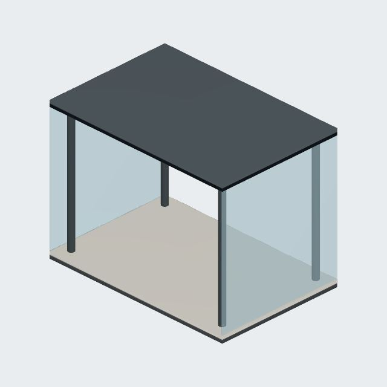
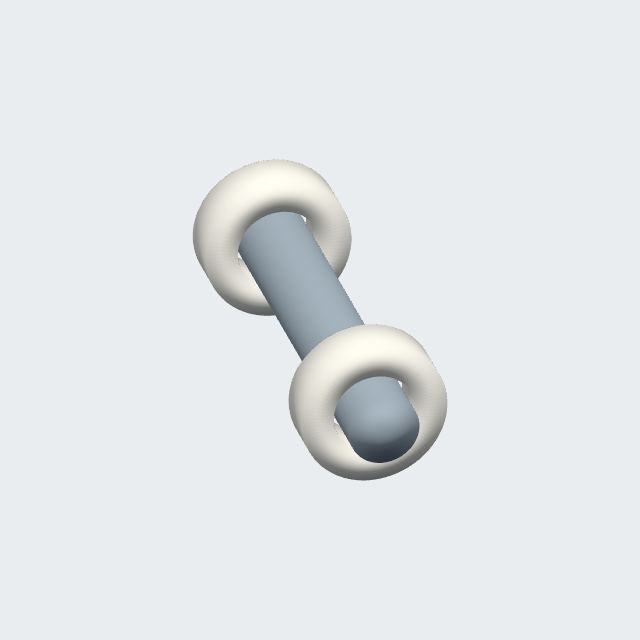
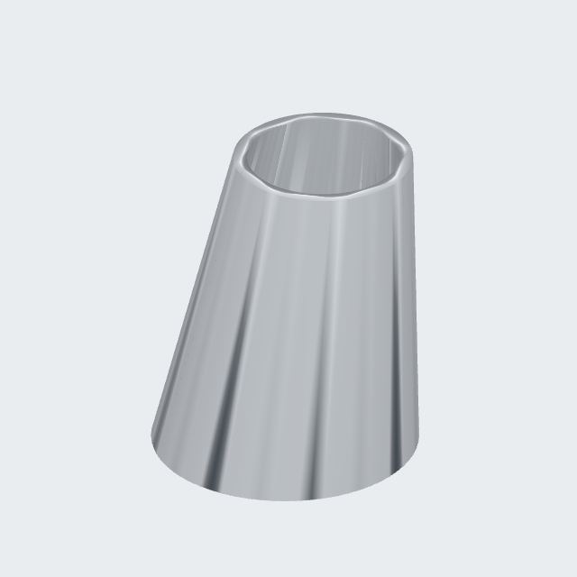

# Requirement coverage and visual observations

This is a post-run audit, not a change to the frozen pass/fail rules. [criterion-coverage.json](criterion-coverage.json) contains the exact request citations, generated criteria, selectors, scope and observed host results. [analysis.json](analysis.json) lists per-turn measurements and feedback. The archive contains full inputs and outputs.

| Turn | Prompt requirements independently measured | What the host checked | Material gap or qualification |
| --- | --- | --- | --- |
| A1 | 4.8 × 3.2 × 0.18 m grounded platform; aligned 0.16 m roof; 2.7 m clearance; four 0.16 m round posts at 0.30 m insets; connected supports; glazed short sides; open long sides; clear central space; visible editable objects; unrelated scene preservation | Floor/roof shapes and world dimensions, clearance and alignment offsets, four post diameters/elevations/insets, glass category and pane span/edge position | Pane continuity, open front/back and construction quality disclosed as unverified. External probes establish the first two. Material and structural quality are not physical certifications. |
| A2 | Clearance 3.25 m; roof rise 0.55 m; post/glazing extension; platform data exact; original IDs, horizontal datum, designations, visibility and unrelated objects preserved | Geometry/elevation/preservation criteria passed | Overall host `verified` applies to compiled change criteria, not retrospective proof of every original qualitative requirement. |
| B1 | Seven solids; 2.1 × 0.75 × 0.06 m top at 0.90 m; four 0.08 m square legs at 0.12 m outside setbacks; two distinct rails joining both leg pairs; explicit oak top; editability and protected objects | Counts, top/leg dimensions, oak top, setbacks, multiple touching relationships and editability | The host could not classify arbitrary timber designations. Supplemental saved-data review found `oak` on all legs and rails. Join strength/craftsmanship is not established by geometric contact. |
| B2 | 2.50 m centered top; legs move outward 0.20 m each; same sections/elevations/setbacks; lengthened connected rails; seven original IDs; unrelated geometry exact | New lengths, exact positions/preservation and contacts | Host retained an unverified structural/craftsmanship limitation, which is outside physical certification. No correct geometry was rejected. |
| C1 | Three actual solids; two annuli with 0.50/0.28 m OD/bore and 0.16 m axial length; 0.90 m center spacing; 0.24 × 1.30 m shaft; common 29° axis; midpoint (0,0.8,0); 0.02 m radial clearance; 0.12 m equal overhangs; POM/stainless assignments; independent editability | Counts, designations, positions, actual envelopes/volume, true shaft diameter, solid disjointness and editability | Intrinsic annular shape, complete coaxial relationship and equal overhangs disclosed as unverified. C1 also encountered the equivalent POM-label false rejection documented in RESULTS. |
| C2 | Northeast bushing moves 0.25 m along axis; southwest data exact; shaft length 1.55 m and center shift 0.125 m; original sections/bores/clearance/overhangs and IDs; unrelated scene exact | Target positions, length, preservation and relevant geometry criteria | First candidate passed external tolerance but millimeter rounding failed the reviewer's 0.1 mm position checks. Extra-precision positioning resolved it. |
| D1 | One connected occupied shell against expected form; 1.40 m height; circular profile radii taper from 0.55 to 0.37 m; center shifts +0.22 m X; open cavity; 0.06 m horizontal radial wall and 0.08 m closed base; real sections and empty-space probes | Count, bounds/volume and partial void evidence | Exact section profiles, radial thickness, topology and open top disclosed as unverified; smooth appearance is qualitative. This baseline validates a tessellated solid, not analytic NURBS continuity. |
| D2 | One retained shell ID; 0.16 m front opening centered at y=0.60 and the section center x; front-only removal; opposite wall, base and geometry outside the cut preserved; no leftover cutter | Partial empty-region test, identity/scope and available bounds checks | Host disclosed inability to prove the complete circular opening or localized original-solid preservation. External before/after solid comparison and probes supply that evidence. |
| E1 | Ten separate regular six-sided prisms, 0.30 m across flats and 0.46 m tall; two rows of five; 0.72 m pitch, 0.64 m separation, half-pitch positive-side stagger; 31° frame and zero centroid; grounded bases; unrelated objects preserved | Count, height, explicit point set and independent editability | Host could not certify the regular hexagonal section, across-flat size or all-prism shape equality. External polygon/volume checks establish them. |
| E2 | Pitch becomes 0.90 m; preserved separation/half-pitch stagger, center, yaw, shape, height, IDs and protected objects | Position and original-data preservation checks | No host limitation emitted for the change. Original shape validity remains independently established by the external measurements. |
| F1 | Calibration block is vertically 0.90 m initially; no geometry/group/history change after incompatible final heights | Agent asks which of 0.90/1.40 m should take precedence; no independent modeling review needed | Semantic review of the actual response confirms meaningful clarification. Merely unchanged geometry would not by itself prove understanding. |
| F2 | 1.30 × 0.60 m wedge; grounded flat bottom; top rises linearly 0.20→0.55 m along +X; occupied volume 0.2925 m³; clear of existing items; original block and markers exact | Count, world dimensions, base, volume and separation | Complete planar slope/end-height shape disclosed as unverified. External occupied-solid comparison establishes the wedge geometry. |
| R | Same frozen E1 contract; measured correct original; injected 0.19 m error; repaired same ID; all other components/groups exact | Correctly blocked injected error, then incorrectly blocked correct layout because of two generated coordinate values | Genuine completion failure. Three post-repair measurement rounds found correct external geometry but cached host criteria still failed. No R final commit claimed. |

The external acceptance geometry uses the same CAD kernel with separately written mathematical targets and measurements. It is not proof against a defect shared by all kernel consumers. Sampled sections/probes and tessellation tolerances establish the frozen benchmark contract, not every continuous or physical property.

## Grounded visual review

Method: the actual saved committed geometry was rendered offline through ATELIER's neutral observation renderer. Task components were framed separately from protected sample objects; source IDs and excluded IDs are recorded in [visual/manifest.json](visual/manifest.json). No reference image, AI image generation or geometry modification was used. Complete browser screenshots with the surrounding workspace are retained in the archive.

Codex visually inspected the final oblique images for A2, B2, C2, D2, E2 and F2:

- A2: coherent elevated roof, four slender supports, transparent side screens and open central space. Precise headroom comes from measurements.
- B2: coherent long bench and four legs. The upper view obscures the apron rails; their joins are established numerically, not claimed visible here.
- C2: two bored collars with a common shaft are visible. Smooth-shading at the annular rims can look rounded; actual profiles/clearance come from solid measurements.
- D2: open tapered/sheared shell is visible, with noticeable tessellation/shading bands. The front opening is on the far side of this view; its existence and opposite-wall preservation are numerical findings, not a claimed visual observation from this angle.
- E2: ten regular-looking polygonal columns in two staggered rows. Exact pitch, angle and centering are numerical findings.
- F2: a continuous sloping wedge is visible. Surface-normal shading is simplified; exact planar geometry and volume are measured.

These are qualitative observations, not a photorealism, engineering adequacy or unrestricted aesthetic-quality score.
