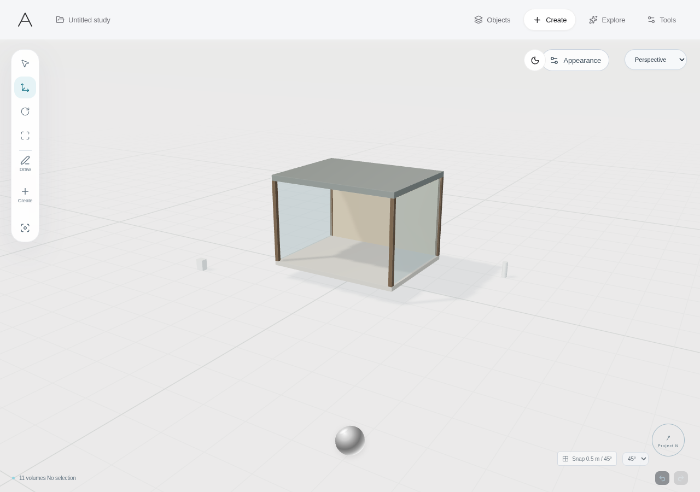
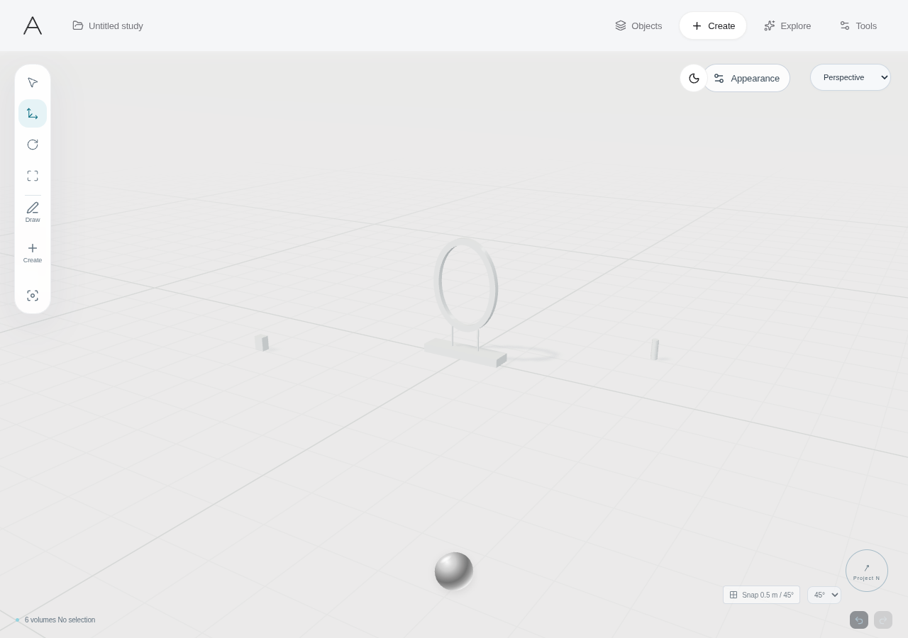

# ATELIER workshop campaign — running evidence

Evaluation only; no application behavior, production branch or deployment changed.

## Published batch: console creation and follow-up

**Both versions created and committed a coherent, grouped, four-piece console.** The original paid creation runs passed every independent geometric check, but their browser persistence checks hit evaluator issues. Those interrupted records remain unchanged. Using the actual saved AI-created consoles and conversation, fresh follow-ups then ran through the browser; creation restoration and the edited results both passed reload and exact geometry/context Undo/Redo checks.

| Boundary | Stable baseline | `f5ba626` |
|---|---|---|
| Creation | Correct four editable solids and preserved reference objects | Same |
| Starting-model inspection during follow-up | Used available scene context; no explicit inspection call | Independently called `inspect_scene` with `snapshot: before` and the top as relative reference |
| Follow-up intent | Widen by 42 cm while preserving overhangs and connected parts | Same |
| Independent feedback | Detected a stretcher connection issue; fresh agent attempted repair | Same |
| Final measurement | Committed; supports and stretcher shifted 0.5 mm toward +X relative to the ideal centered edit | Passed all frozen external checks |
| Identities / unrelated objects | Preserved | Preserved |
| Reload / single Undo / Redo / conversation / camera | Passed in resumed browser workflow | Passed in resumed browser workflow |

The baseline's 0.5 mm displacement fails the frozen occupied-solid comparison for the thin support slabs, although it is below the protocol's general 2 mm position allowance. Preserve the strict result and actual measured discrepancy; **do not describe this as materially wrong architecture or strong statistical evidence of superiority**. It is a small precision difference. Both are usable edited consoles, and one matched pair is insufficient to establish reliability. The second arm spent more calls inspecting the original state; its final placement was exact under these measurements.

One extra baseline fixture-based edit was run by the initial harness after its persistence assertion. Its geometry passed, but it is a separately seeded diagnostic, not an end-to-end success. A baseline W2 attempt started before the coordinator stopped for the harness correction; it remains interrupted and will be rerun with the corrected harness. All charges are retained.

This published segment includes **18 calls, estimated $0.622392**, with usage returned for all calls and no unknown-charge reservation. Includes initial failures, the diagnostic and the interrupted W2 call. Estimated rates are $2/M input and $10/M output from the secondary pricing snapshot; not a confirmed invoice. The ongoing campaign totals are in [spending.json](spending.json).

## Reviewable evidence

- [Frozen protocol and scoring](PROTOCOL.md)
- [Current evaluation hash manifest](FREEZE.json), [original manifest](FREEZE-v1.json)
- [Boundary-by-boundary console results](console-boundaries.json)
- [Initial interrupted results](workshop-1-results.json), [resumed follow-up results](console-resume-results.json)
- [Full console traces, API usage, editable scene snapshots, screenshots and browser persistence evidence](artifacts/console-evidence.tar.gz)
- [Evaluator corrections, retained failures and their limits](HARNESS-CORRECTIONS.md)
- [Offline geometric calibration](offline-geometry-v2.json), [browser calibration](offline-browser-v2.json), [camera numeric calibration](camera-calibration.json)

## Second published batch: workshop arm across three domains

| Task on `f5ba626` | Creation | Follow-up | Evidence |
|---|---|---|---|
| Garden enclosure | Passed: nine editable components | Passed: floor +0.38 m, seven uprights shortened, roof and unrelated objects preserved | Reload, one Undo and Redo passed |
| Bored roller assembly | Did not commit: group ID was interpreted as a required group name | Separate fixture edit did not commit: reviewer exhausted its 6,000-token output allowance after 91 seconds | Failures retained; not counted as successes |
| Elliptical halo sculpture | Passed: actual rim/opening, two connected round supports, separate plinth | Passed: halo +0.28 m, supports extended from fixed feet, curved shape and opening preserved | Reload, one Undo and Redo passed |

The roller result is particularly revealing. An **offline replay of the saved AI operations** produces actual solids that pass the external geometry checks, including the bores. The unchanged reviewer still blocks that candidate because its `group.name` requirement contains the group's UUID. In an **analysis-only counterfactual**, replacing that ID with its actual name makes the candidate commit-eligible, with unsupported circular-void classification still disclosed as unverified. This establishes a criterion-reference mismatch; it does not establish a live commit, implement a fix, or count as a fresh-AI repair success.

The baseline garden-room rerun also produced a blocked creation: the reviewer interpreted footprint containment as a requirement to **fill the entire room volume**. The executor recognized that this would destroy the requested hollow room and refused to alter valid geometry to satisfy the mistaken check. Offline replay passes the same external solid oracle. Its separately seeded floor-height edit passed. This baseline result is not an end-to-end success. The completed baseline roller creation/edit and halo creation/edit both passed all solid and persistence checks.

The completed workshop-arm segment used **31 calls, estimated $1.262998**. [Full traces, measurements, saved models, interrupted baseline-start evidence, and labeled offline replay](artifacts/workshop2-evidence.tar.gz). The independent original conditions and all paid failures remain preserved.

Actual saved results, reopened in the normal workspace **without new AI calls**, with conversation minimized and occupied solids checked unchanged:

The comparisons below are separate from this initial workshop batch. No recommendation to merge or deploy is implied by interim results.

## Separate verifier comparison — first matched round

Both the stable baseline and `433d9ba` correctly created the sloped circular arrangement, reflected the three different existing solids, and blocked the deliberately displaced 40 mm negative control. The positive results actually committed and passed reload and Undo/Redo; the negative control left the project unchanged. The wrong candidate was scripted fault injection; its interpretation and review used fresh AI. The positive requests used fresh executor and reviewer responses.

`433d9ba` emitted one deterministic calculation for the arrangement and three calculations grounded in the pre-edit model for the reflection. The baseline used literal expected positions. This proves calculation provenance was used in a real workflow, **not a higher success rate**: both versions passed. Reviewer times were 13.4/23.1 seconds for the arrangement, 13.7/27.5 seconds for the reflection, and 15.0/17.8 seconds for the negative control (baseline/433). All ten calls cost an estimated **$0.299856**.

[Raw first-round results](verifier-1-results.json) · [Full reviewer calculations, geometry, browser state and calls](artifacts/verifier-evidence.tar.gz) · [Completed baseline workshop evidence](artifacts/baseline-fill-evidence.tar.gz)

## Transfer cases — rotated tapered supports and connected ramps

Both versions created and successfully edited the rotated workbench. The follow-up asked only to raise its working surface 23 cm while keeping the feet and top form fixed. Both independently extended all four tapered legs, preserved their identities and the unrelated reference samples, and saved the correct result with functional reload and Undo/Redo. `f5ba626` explicitly inspected the before-state group; the baseline used the original inventory/conversation already supplied by the application. **Absence of an explicit inspection call is not evidence that it ignored available state.**

Both five-part ramp creations also had correct solids. An evaluator-only Float32 volume-consistency false flag was diagnosed and corrected in revision 4; original records remain intact. See [correction record](HARNESS-CORRECTIONS.md). The resulting fixture-edit diagnostics are kept separate: the baseline failed after trying a prohibited mid-transaction Undo; `f5ba626` used before/compare inspection and repaired an exact-metadata mismatch (`1.2` versus `1.2000000000000002`). This was useful recovery, though the trigger is itself an over-strict application verification issue.

Fresh edits were then performed on the **actual saved AI-created ramps**. Both produced the right solids, changing the middle platform and both connecting ramps while preserving the end platforms, identities and unrelated samples. Both passed reload and Undo/Redo. The baseline received a strict PASS. `f5ba626` retains a strict `COMMITTED_INCORRECT` row only because it sensibly renamed “platform 55 cm” to “platform 73 cm”; all geometric checks passed. [Label audit](ramp-name-audit.json). This is not evidence of incorrect geometry or a meaningful baseline advantage. Neither host claimed it could fully certify continuous walking surfaces; the separate occupied-solid oracle did establish the requested wedge connections.

The transfer batch used an estimated **$1.460112**, including the separately seeded diagnostics. Fresh resumed ramp edits added **$0.211714**. [Raw transfer results](transfer-1-results.json) · [Resumed ramp results](ramp-resume-results.json) · [Full transfer traces, saved editable models, numerical reassessments and browser checks](artifacts/transfer-evidence.tar.gz)

Selected fresh matched repeats and same-project recovery after a blocked transaction are in progress. All applications remain frozen. Current cumulative spending is an estimate in [spending.json](spending.json), including in-flight reservations when present.
